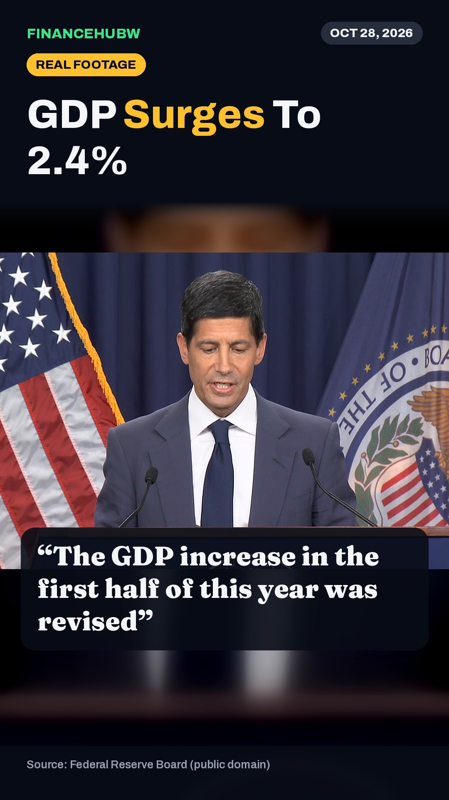
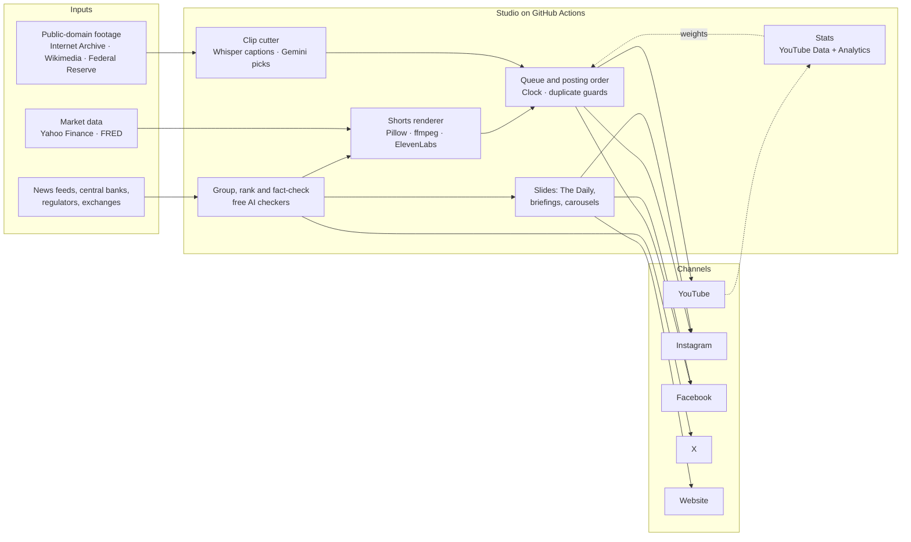

<div align="center">


### Money, explained in under a minute. Researched, fact-checked, produced and published by code.

[](https://github.com/financehubw/FinanceHubW/actions/workflows/social.yml)
[](https://github.com/financehubw/FinanceHubW/actions/workflows/clips.yml)
[](https://github.com/financehubw/FinanceHubW/actions/workflows/post.yml)
[](https://github.com/financehubw/FinanceHubW/actions/workflows/stats.yml)
<br>
[](LICENSE)
[](CONTENT_LICENSE.md)
[](.github/workflows)
[](requirements.txt)

**[YouTube](https://www.youtube.com/@FinanceHubW)** · **[Instagram](https://www.instagram.com/financehubw)** · **[Facebook](https://www.facebook.com/profile.php?id=1350820541447560)** · **[X](https://x.com/FinanceHubW)** · **[Website](https://financehubw-site.vercel.app)**

</div>

<p align="center">
  
  
  
  
  
</p>
<p align="center"><sub>Recent covers. Every published Short, with views and a download link, is in <a href="SHORTS.md"><b>SHORTS.md</b></a>.</sub></p>

---

FinanceHubW is a finance media studio that runs entirely on GitHub Actions: no servers, no paid infrastructure. It finds
and fact-checks the day's money news, turns it into vertical Shorts, slide editions and story cards, clips
public-domain footage of the moments that shaped money, publishes to YouTube, Instagram, Facebook and X, and tunes
what it posts from its own analytics.

## Contents

- [What it publishes](#what-it-publishes)
- [How it works](#how-it-works)
- [Schedules](#schedules)
- [Repository layout](#repository-layout)
- [Quality and safeguards](#quality-and-safeguards)
- [Running it](#running-it)
- [Data and reports](#data-and-reports)
- [Credits](#credits)
- [License and disclaimer](#license-and-disclaimer)

## What it publishes

| Format | Channels | Cadence | Built by |
|---|---|---|---|
| **Real-footage money history**: presidents, newsreels and classroom films in their own words, captioned, ending on a live "today" figure | YouTube Shorts, Reels, Facebook | In the daily rotation | [`social/clips.py`](social/clips.py) |
| **Fed Watch**: the strongest answers from each Federal Reserve press conference | YouTube Shorts, Reels, Facebook | After every FOMC meeting | [`social/clips.py`](social/clips.py) `auto` |
| **Money stories, lessons and data races**: voiced Shorts with live market data | YouTube Shorts, Reels, Facebook | 4 Shorts a day in total | [`social/shorts_factory.py`](social/shorts_factory.py), [`formats.py`](social/formats.py), [`whatif.py`](social/whatif.py) |
| **10-second loops**: one money rule that ends where it begins | YouTube Shorts, Reels, Facebook | In the daily rotation | [`social/shorts_factory.py`](social/shorts_factory.py) (`"loop": true`) |
| **Same-day news Short** | YouTube Shorts, Reels, Facebook | Weekdays | [`social/news_short.py`](social/news_short.py) |
| **The Daily**: a slide edition of the day's markets, plus the daily briefing carousel | Instagram, Facebook, website | Weekdays (briefing daily) | [`magazine/daily_free.py`](magazine/daily_free.py), [`social/x_story.py`](social/x_story.py) |
| **Learn carousels**: one money concept per carousel | Instagram, Facebook | Mon, Wed, Fri | [`social/edu.py`](social/edu.py) |
| **Weekly long video**: the week's Shorts as a 16:9 episode with chapters | YouTube | Sundays | [`social/compile_long.py`](social/compile_long.py) |
| **News posts**: fact-checked headlines with context | Website feed, Instagram | Every 2 hours | [`xbot/bot.py`](xbot/bot.py) |
| **Top story on X** | X | Every 3 days, plus a one-tap share page | [`social/typefully_post.py`](social/typefully_post.py), [`site/x.html`](site/x.html) |

## How it works



1. **Find and verify.** [`xbot/sources.py`](xbot/sources.py) reads newsrooms, exchanges, central banks and regulators
   plus Google News searches across regions. Stories are grouped across outlets. A story only qualifies if two
   independent outlets report it or it comes from an official body, and every number is checked by independent AI
   checkers ([`xbot/verify.py`](xbot/verify.py)): one FAIL blocks the post.
2. **Make.** Scripts are plain JSON ([`social/shorts_scripts/`](social/shorts_scripts)). The renderer animates
   scenes, fetches live prices at render time, and voices them with ElevenLabs (free Microsoft voice as fallback).
   Real-footage clips are cut from public-domain sources, captioned with Whisper word timings and laid out in a fixed
   newsroom template. Gemini picks the strongest moments from new Fed press conferences.
3. **Publish.** [`social/publish.py`](social/publish.py) posts the next Short everywhere at once. The order comes from
   [`social/mix.py`](social/mix.py), which rotates kinds of Shorts by weight. [`clock.yml`](.github/workflows/clock.yml)
   fires each slot on time, because GitHub's own cron drops many runs.
4. **Learn.** Every night [`social/yt_stats.py`](social/yt_stats.py) pulls views, watch-through and subscribers per
   Short, recomputes the posting weights, and keeps every Short in its series playlist.
   [`social/best_times.py`](social/best_times.py) moves posting times to when the audience responds.

## Schedules

Times are UTC (India is UTC+5:30). Every workflow can also be run by hand from the Actions tab.

| Workflow | When | What it does |
|---|---|---|
| [Clock](.github/workflows/clock.yml) | Always running | Fires each Shorts slot on time (learned weekly; now 06:30, 14:00, 18:30, 22:30) |
| [Post Short](.github/workflows/social.yml) | Each slot | Posts the next Short to YouTube, Instagram and Facebook |
| [Post finance update](.github/workflows/post.yml) | Every 2 h | News posts, Instagram Stories, the daily briefing, comment replies |
| [Real-footage clips](.github/workflows/clips.yml) | Daily 21:41 | Clips new Fed press conferences; tops up history clips |
| [Make Shorts](.github/workflows/make-shorts.yml) | Mon, Thu 04:17 | Writes new data scripts and renders new Shorts |
| [Same-day news Short](.github/workflows/news-short.yml) | Weekdays 12:05 | The day's biggest fact-checked story as a Short |
| [Daily draft](.github/workflows/daily-draft.yml) | Weekdays 12:40 | Writes, checks and renders The Daily |
| [Post magazine](.github/workflows/magazine.yml) | Daily 15:23 | Publishes The Daily (with retries) |
| [Learn carousel](.github/workflows/edu.yml) | Mon, Wed, Fri | Posts a Learn carousel |
| [Weekly long video](.github/workflows/long-video.yml) | Sun 12:37 | Builds and uploads the weekly episode |
| [Channel stats and archive](.github/workflows/stats.yml) | Daily 23:52 | Stats, posting weights, playlists, the Shorts archive and `SHORTS.md` |
| [Learn best posting times](.github/workflows/best-times.yml) | Sun 06:07 | Re-learns posting times from reach |
| [X via Typefully](.github/workflows/typefully.yml) | Every 3 days | The top story to X through Typefully |
| [Watchdog](.github/workflows/watchdog.yml) | Daily 04:41 | Flags anything that stopped posting |
| [Check news sources](.github/workflows/check-sources.yml) | Mon 03:00 | Finds dead feeds |

## Repository layout

```
.github/workflows/   schedules and pipelines (one file per job)
xbot/                news: sources, ranking, writing, fact-checking (verify.py), posting
social/              Shorts: scripts, renderer, real-footage clips, queue, publishing, stats, archive
  shorts_scripts/    one JSON script per Short
  clip_sources/      transcripts of public-domain footage (word timings)
  clip_specs/        one JSON spec per real-footage clip
magazine/            The Daily and The Weekly: templates, renderer, photos
motion/              motion-graphics engine, sound design, fonts
site/                the website (deployed by Vercel) and the media it serves
brand/               logo, profile pictures, banners (source SVGs and PNGs)
docs/                public standards and corrections page
logs/                the latest log of each pipeline, committed by the runs themselves
SHORTS.md            every published Short (generated daily)
```

## Quality and safeguards

- **Accuracy:** multi-source rule, independent AI fact-checkers on every number, and a public
  [corrections log](docs/corrections.json).
- **Rights:** footage comes only from the public domain or open licenses, and the source is credited on screen and
  in every description. Photos come from Pixabay. Nothing is downloaded from YouTube.
- **Disclosure:** AI narration is labelled in captions and with YouTube's altered-content setting.
- **No duplicates:** each platform is checked for the same title or caption before posting. Instagram gets at most
  one feed post every 2 hours, and posts are confirmed live before anything is marked failed.
- **Self-healing:** missed slots are caught up, platforms that failed are retried for 3 days, AI models fall back
  to the next free provider, and a watchdog reports anything that stopped.
- **Secrets:** API keys live only in GitHub Secrets and are never written to the repo or logs (see
  [SECURITY.md](SECURITY.md)).

## Running it

**Secrets** (Settings → Secrets and variables → Actions). Only the platforms you set up are used.

| Secret | Used for |
|---|---|
| `YT_TOKEN_JSON` | YouTube uploads, playlists, stats (OAuth token with YouTube and YouTube Analytics scopes) |
| `META_TOKEN`, `IG_USER_ID`, `FB_PAGE_ID` | Instagram and Facebook publishing |
| `GEMINI_API_KEY`, `GROQ_API_KEY`, `OPENROUTER_API_KEY` | Writing and fact-checking (free tiers) |
| `ELEVENLABS_API_KEY` (+ variable `ELEVEN_VOICE_ID`) | Voice-over (falls back to a free voice) |
| `PIXABAY_API_KEY` | Background photos and video |
| `TYPEFULLY_API_KEY` | Posting to X |

**Manual runs** with the GitHub CLI:

```bash
gh workflow run social.yml                                   # post the next Short now
gh workflow run make-shorts.yml -f only="loop_rule_of_72"    # render specific scripts
gh workflow run clips.yml -f mode=make -f args="clip_gold33" # render a real-footage clip
gh workflow run clips.yml -f mode=scout -f scout_matrix='["reagan_1981_economy"]'   # transcribe a new source
gh workflow run stats.yml                                    # refresh stats, playlists, archive
```

**Local rendering** (needs ffmpeg):

```bash
pip install -r requirements.txt
python social/shorts_factory.py loop_rule_of_72    # -> site/media/shorts/loop_rule_of_72.mp4
```

## Data and reports

| File | What's in it |
|---|---|
| [`SHORTS.md`](SHORTS.md) | Every published Short: cover, date, views, watch-through, YouTube link, download |
| [`social/yt_stats.json`](social/yt_stats.json) | Per-Short YouTube numbers and traffic sources |
| [`social/format_weights.json`](social/format_weights.json) | How each kind of Short performs, and its share of posting slots |
| [`social/posted.json`](social/posted.json) | Every post, with links per platform |
| [Shorts release](https://github.com/financehubw/FinanceHubW/releases/tag/shorts) | The video file of every published Short |
| [`logs/`](logs) | The latest run of each pipeline |

Videos stay in the repo until they are posted and archived in the release, then they're removed, so the repo stays
small.

## Credits

- **Footage:** Universal Newsreel and Prelinger Archives (public domain) via the [Internet Archive](https://archive.org);
  Ronald Reagan Presidential Library (CC BY 3.0) via [Wikimedia Commons](https://commons.wikimedia.org);
  [Federal Reserve Board](https://www.federalreserve.gov) (public domain).
- **Data:** Yahoo Finance via [yfinance](https://github.com/ranaroussi/yfinance);
  [FRED](https://fred.stlouisfed.org), Federal Reserve Bank of St. Louis.
- **Voice:** [ElevenLabs](https://elevenlabs.io); Microsoft Edge voices via
  [edge-tts](https://github.com/rany2/edge-tts) as fallback.
- **Transcription:** [faster-whisper](https://github.com/SYSTRAN/faster-whisper).
- **Photos:** [Pixabay](https://pixabay.com) (Pixabay Content License).
- **Fonts:** Archivo and Fraunces (SIL Open Font License).

## License and disclaimer

The code is released under the [MIT License](LICENSE). FinanceHubW's posts, editions, videos and brand are
© FinanceHubW, all rights reserved: see [CONTENT_LICENSE.md](CONTENT_LICENSE.md). Third-party footage keeps its own
license, credited above and in each description.

Everything FinanceHubW publishes is educational. **It is not financial advice.**
