# Shorts catalog

Every Short FinanceHubW has published, newest first: 48 so far, 19,288 YouTube views in total.
Views and watch-through (the average share of the Short that people watch) come from the YouTube Data and Analytics
APIs and refresh daily. Each video file is kept in the [`shorts` release](../../releases/tag/shorts).

_Updated 09 Nov 2026, 03:00 UTC by [`social/archive_shorts.py`](social/archive_shorts.py)._

| Cover | Short | Posted | Views | Watched | Links |
|---|---|---|--:|--:|---|
|  | **The Rule of 72 in 10 seconds** 10-second loop · Money Basics | 8 Nov | 120 |  | [YouTube](https://youtube.com/shorts/vxpIpg17p5s) · [Video](https://github.com/financehubw/FinanceHubW/releases/download/shorts/loop_rule_of_72.mp4) |
|  | **How a 1947 film explained money (and what changed in 1971)** Real footage · Money History, in Real Footage | 8 Nov | 66 |  | [YouTube](https://youtube.com/shorts/g7yZiMNcFhI) · [Video](https://github.com/financehubw/FinanceHubW/releases/download/shorts/clip_money47_gold.mp4) |
|  | **How to invest in the S&P 500 (beginner, 30 seconds)** Money lesson · Money Basics | 8 Nov | 121 |  | [YouTube](https://youtube.com/shorts/lFeNNxqha8A) · [Video](https://github.com/financehubw/FinanceHubW/releases/download/shorts/sp500_beginners.mp4) |
| <a href="https://youtube.com/shorts/niYcJfFmCiI">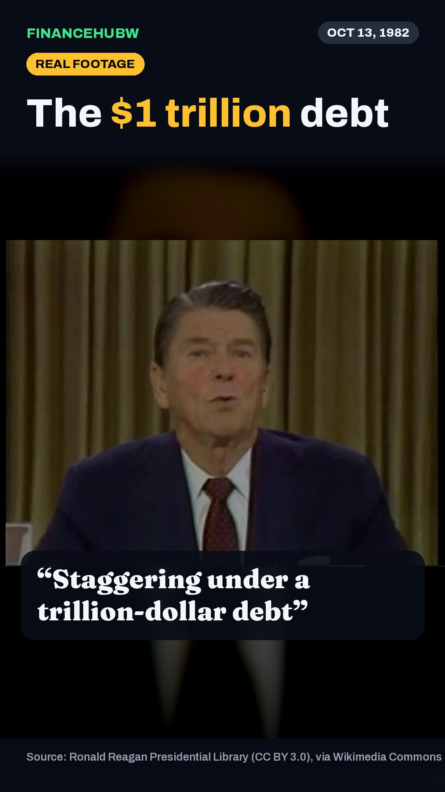</a> | **Reagan warned about a $1 trillion US debt in 1982** Real footage · Money History, in Real Footage | 8 Nov | 3,839 |  | [YouTube](https://youtube.com/shorts/niYcJfFmCiI) · [Video](https://github.com/financehubw/FinanceHubW/releases/download/shorts/clip_reagan82_debt.mp4) |
|  | **How much do you need to retire? The 25x rule** 10-second loop · Money Basics | 8 Nov | 120 |  | [YouTube](https://youtube.com/shorts/QMC1VKVXkn0) · [Video](https://github.com/financehubw/FinanceHubW/releases/download/shorts/loop_retire_25x.mp4) |
| <a href="https://youtube.com/shorts/Ly0PaMVa7_M">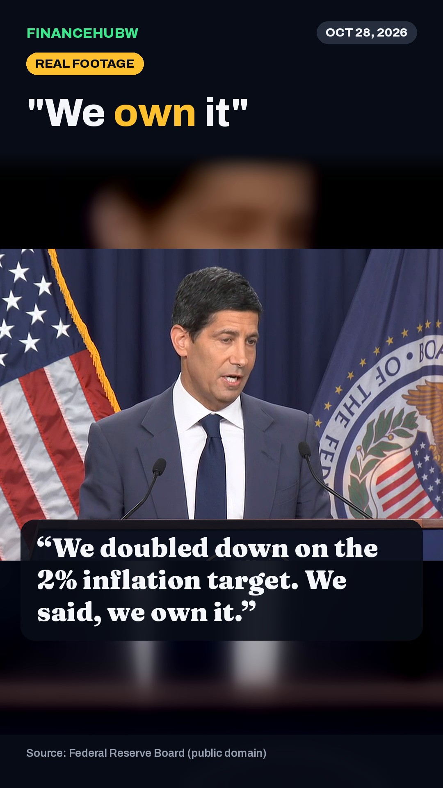</a> | **Fed Chair Warsh: "We own" the 2% inflation target** Real footage · Fed Watch | 7 Nov | 1,586 |  | [YouTube](https://youtube.com/shorts/Ly0PaMVa7_M) · [Video](https://github.com/financehubw/FinanceHubW/releases/download/shorts/clip_fomc_20261028_2.mp4) |
|  | **A secretary secretly built $9 million · Money Stories #8** Money story · Money Stories | 7 Nov | 132 |  | [YouTube](https://youtube.com/shorts/jTcVc7oNh3w) · [Video](https://github.com/financehubw/FinanceHubW/releases/download/shorts/secretary_millionaire.mp4) |
| <a href="https://youtube.com/shorts/plzfW_L_v3I">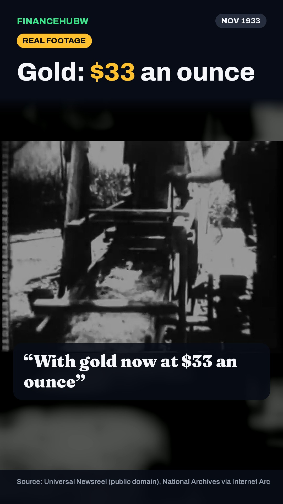</a> | **Gold was $33 an ounce in 1933 (real newsreel)** Real footage · Money History, in Real Footage | 7 Nov | 1,579 |  | [YouTube](https://youtube.com/shorts/plzfW_L_v3I) · [Video](https://github.com/financehubw/FinanceHubW/releases/download/shorts/clip_gold33.mp4) |
| <a href="https://youtube.com/shorts/q6F3GK0qS4A">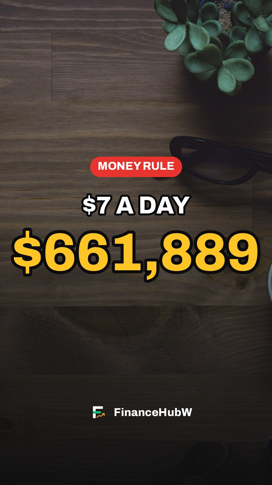</a> | **$7 a day could become $661,889** 10-second loop · Money Basics | 7 Nov | 199 |  | [YouTube](https://youtube.com/shorts/q6F3GK0qS4A) · [Video](https://github.com/financehubw/FinanceHubW/releases/download/shorts/loop_7_dollars_a_day.mp4) |
| <a href="https://youtube.com/shorts/2c487mK0xTw">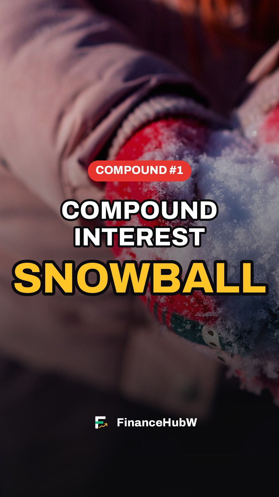</a> | **Compound interest explained in 20 seconds · Compound Interest #1** Money lesson · Compound Interest, Explained | 6 Nov | 239 | 54% | [YouTube](https://youtube.com/shorts/2c487mK0xTw) · [Video](https://github.com/financehubw/FinanceHubW/releases/download/shorts/compound_1_snowball.mp4) |
| <a href="https://youtube.com/shorts/cNuvUk5yHjI">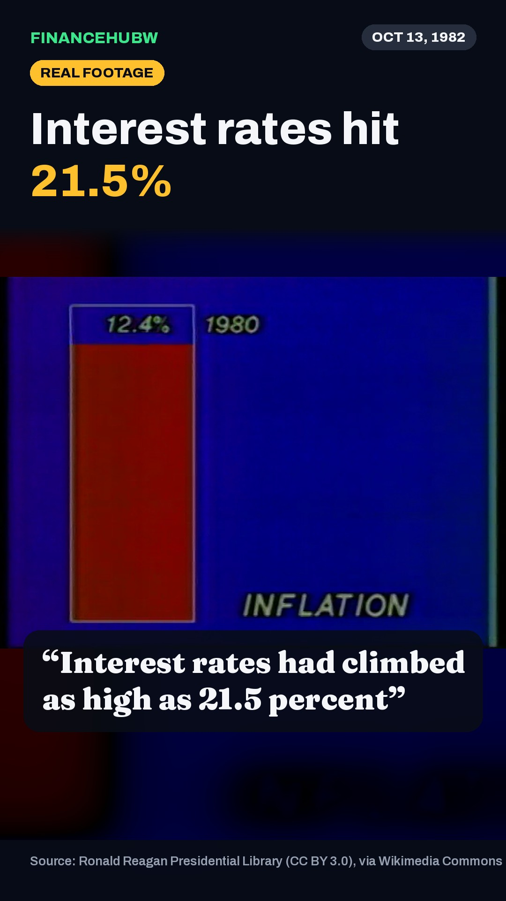</a> | **When US interest rates hit 21.5% (Reagan, 1982)** Real footage · Money History, in Real Footage | 6 Nov | 1,996 | 92% | [YouTube](https://youtube.com/shorts/cNuvUk5yHjI) · [Video](https://github.com/financehubw/FinanceHubW/releases/download/shorts/clip_reagan82_rates.mp4) |
| <a href="https://youtube.com/shorts/-C8VeufkIY4">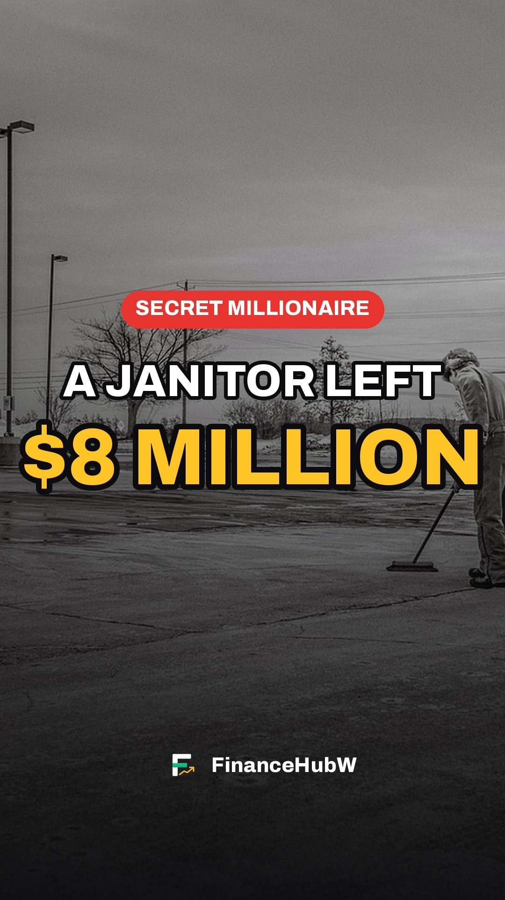</a> | **A janitor quietly left $8 million · Money Stories #7** Money story · Money Stories | 5 Nov | 46 | 94% | [YouTube](https://youtube.com/shorts/-C8VeufkIY4) · [Video](https://github.com/financehubw/FinanceHubW/releases/download/shorts/janitor_millionaire.mp4) |
| <a href="https://youtube.com/shorts/SIoj4UTQfH4">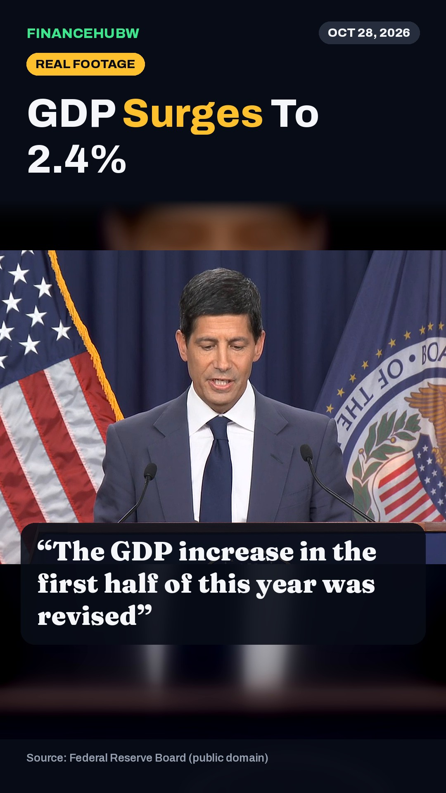</a> | **Fed Chair Warsh: Why not raise interest rates today?** Real footage · Fed Watch | 5 Nov | 1,230 | 49% | [YouTube](https://youtube.com/shorts/SIoj4UTQfH4) · [Video](https://github.com/financehubw/FinanceHubW/releases/download/shorts/clip_fomc_20261028_1.mp4) |
|  | **US stocks and Bitcoin surge after vote (today's money news)** Money news · Today's Money News | 4 Nov | 84 | 88% | [YouTube](https://youtube.com/shorts/KuVzYKh8lJQ) · [Video](https://github.com/financehubw/FinanceHubW/releases/download/shorts/news_20261104.mp4) |
| <a href="https://youtube.com/shorts/kGavwRgGC1E">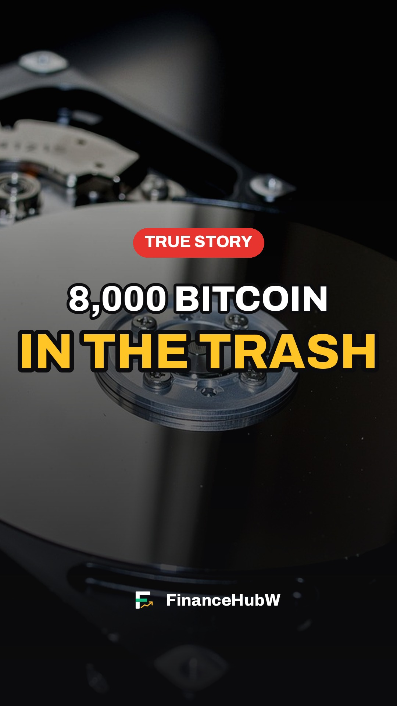</a> | **He threw away a hard drive with 8,000 bitcoin · Money Stories #6** Money story · Money Stories | 4 Nov | 69 | 63% | [YouTube](https://youtube.com/shorts/kGavwRgGC1E) · [Video](https://github.com/financehubw/FinanceHubW/releases/download/shorts/hard_drive_bitcoin.mp4) |
| <a href="https://youtube.com/shorts/QTETFzWwr1c">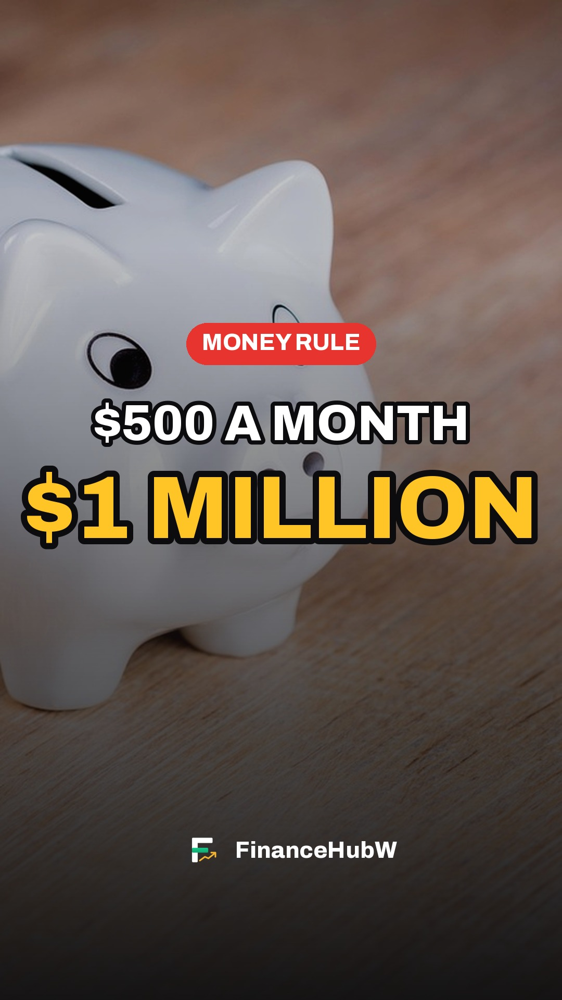</a> | **$500 a month can make you a millionaire** 10-second loop · Money Basics | 4 Nov | 3 | 0% | [YouTube](https://youtube.com/shorts/QTETFzWwr1c) · [Video](https://github.com/financehubw/FinanceHubW/releases/download/shorts/loop_500_a_month.mp4) |
| <a href="https://youtube.com/shorts/6i3033fF3B4">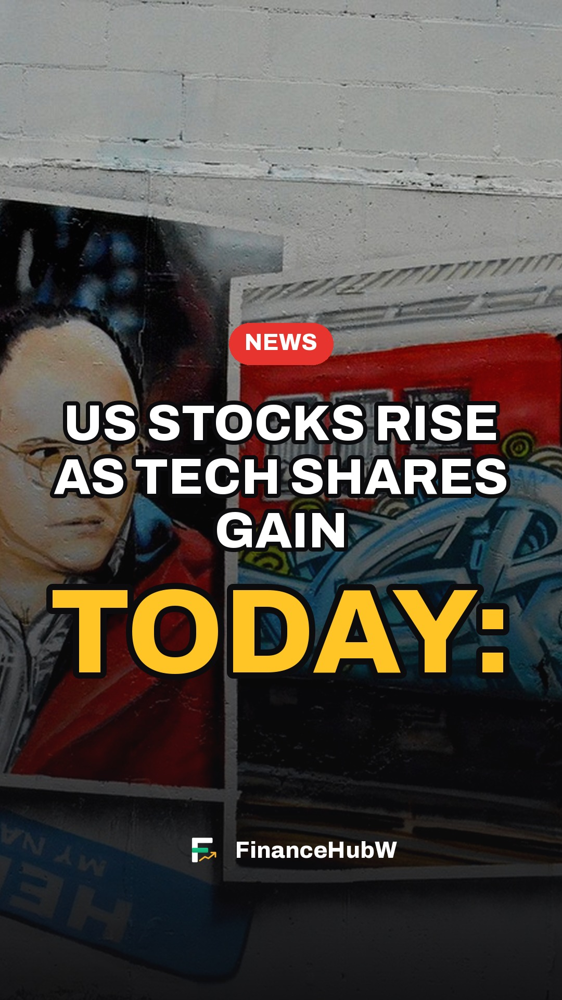</a> | **US stocks rise as tech shares gain (today's money news)** Money news · Today's Money News | 3 Nov | 90 | 56% | [YouTube](https://youtube.com/shorts/6i3033fF3B4) · [Video](https://github.com/financehubw/FinanceHubW/releases/download/shorts/news_20261103.mp4) |
| <a href="https://youtube.com/shorts/wQ6Ed_6ahj8">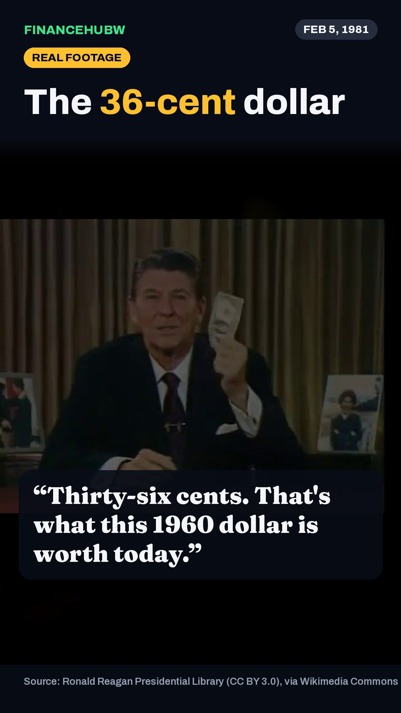</a> | **Reagan shows what inflation did to the dollar (1981)** Real footage · Money History, in Real Footage | 3 Nov | 4,258 | 101% | [YouTube](https://youtube.com/shorts/wQ6Ed_6ahj8) · [Video](https://github.com/financehubw/FinanceHubW/releases/download/shorts/clip_reagan81_36cents.mp4) |
| <a href="https://youtube.com/shorts/B4YeM3XlOwk">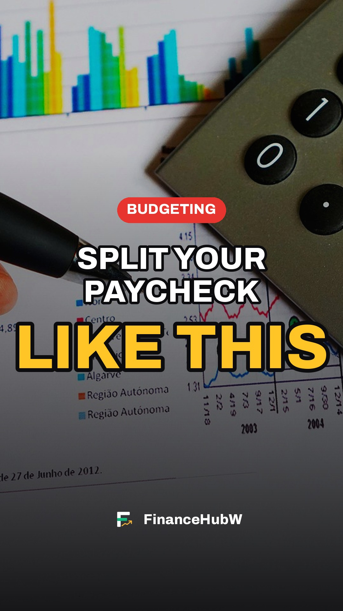</a> | **How to split every paycheck (the 50/30/20 rule)** Money lesson · Money Basics | 3 Nov | 90 | 74% | [YouTube](https://youtube.com/shorts/B4YeM3XlOwk) · [Video](https://github.com/financehubw/FinanceHubW/releases/download/shorts/paycheck_split.mp4) |
|  | **One joke wiped out £500 million · Money Stories #5** Money story · Money Stories | 3 Nov | 194 | 78% | [YouTube](https://youtube.com/shorts/bd5aJuyjo8Y) · [Video](https://github.com/financehubw/FinanceHubW/releases/download/shorts/ratner_joke.mp4) |
|  | **3 money mistakes in your 20s that cost the most** Money lesson · Money Mistakes | 2 Nov | 35 | 46% | [YouTube](https://youtube.com/shorts/oBo8QbBT8Tw) · [Video](https://github.com/financehubw/FinanceHubW/releases/download/shorts/mistakes_20s.mp4) |
| <a href="https://youtube.com/shorts/4szkjKSn-jA">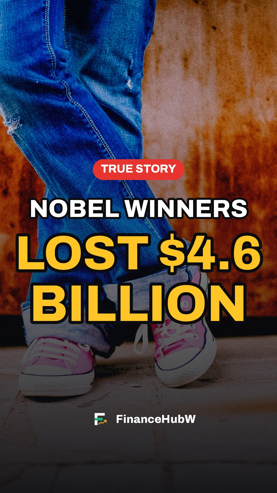</a> | **Nobel prize winners ran a fund that nearly broke Wall Street · Money Stories #4** Money story · Money Stories | 2 Nov | 67 | 56% | [YouTube](https://youtube.com/shorts/4szkjKSn-jA) · [Video](https://github.com/financehubw/FinanceHubW/releases/download/shorts/ltcm_nobel_fund.mp4) |
| <a href="https://youtube.com/shorts/vxDzuaNJulo">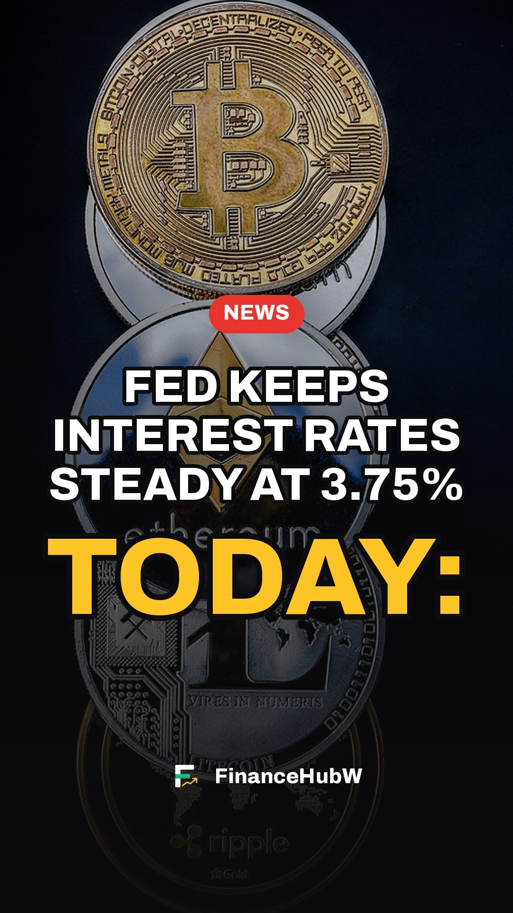</a> | **Fed keeps interest rates steady at 3.75% to 4% (today's money news)** Money news · Today's Money News | 29 Oct | 31 | 53% | [YouTube](https://youtube.com/shorts/vxDzuaNJulo) · [Video](https://github.com/financehubw/FinanceHubW/releases/download/shorts/news_20261029.mp4) |
|  | **Isaac Newton lost a fortune in a stock bubble · Money Stories #3** Money story · Money Stories | 29 Oct | 45 | 47% | [YouTube](https://youtube.com/shorts/aQ6DUSIjmxU) · [Video](https://github.com/financehubw/FinanceHubW/releases/download/shorts/newton_south_sea.mp4) |
|  | **He tried to buy a fighter jet with Pepsi points · Money Stories #2** Money story · Money Stories | 28 Oct | 133 | 91% | [YouTube](https://youtube.com/shorts/R0WZMF3ZNr4) · [Video](https://github.com/financehubw/FinanceHubW/releases/download/shorts/pepsi_harrier_jet.mp4) |
|  | **Kodak invented the digital camera, then went bankrupt · Money Stories #1** Money story · Money Stories | 28 Oct | 81 | 54% | [YouTube](https://youtube.com/shorts/fiddrA5mOqM) · [Video](https://github.com/financehubw/FinanceHubW/releases/download/shorts/kodak_digital_camera.mp4) |
| <a href="https://youtube.com/shorts/4qhcdQ8mtr8">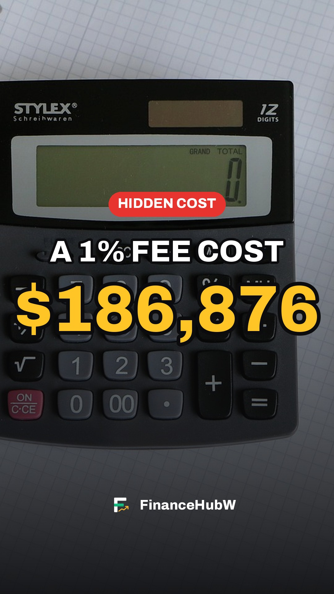</a> | **A 1% fee costs more than you think** Money lesson · Money Basics | 27 Oct | 94 | 72% | [YouTube](https://youtube.com/shorts/4qhcdQ8mtr8) · [Video](https://github.com/financehubw/FinanceHubW/releases/download/shorts/one_percent_fee.mp4) |
| <a href="https://youtube.com/shorts/-qTry0G9T1Y">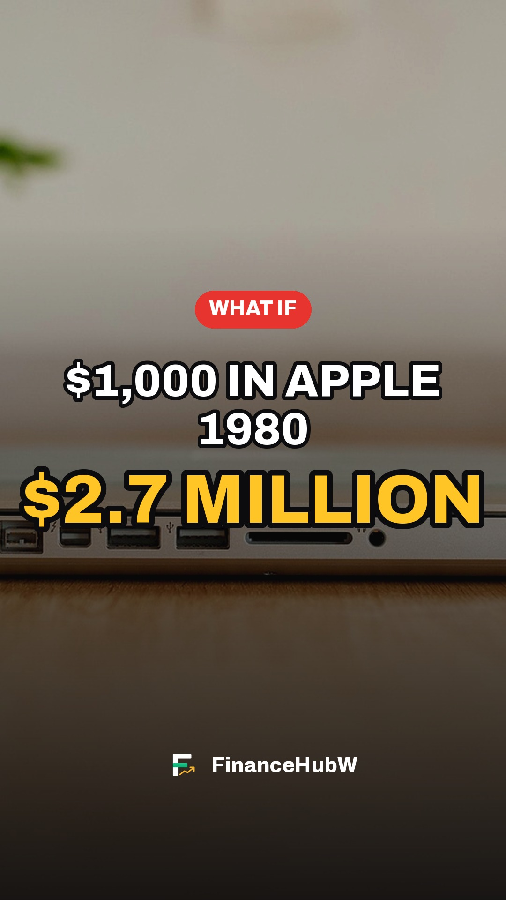</a> | **$1,000 in Apple's first trading day is now worth this** Data race · What If You Invested? | 27 Oct | 235 | 65% | [YouTube](https://youtube.com/shorts/-qTry0G9T1Y) · [Video](https://github.com/financehubw/FinanceHubW/releases/download/shorts/apple_ipo.mp4) |
| <a href="https://youtube.com/shorts/dFxZ2gKHrn0">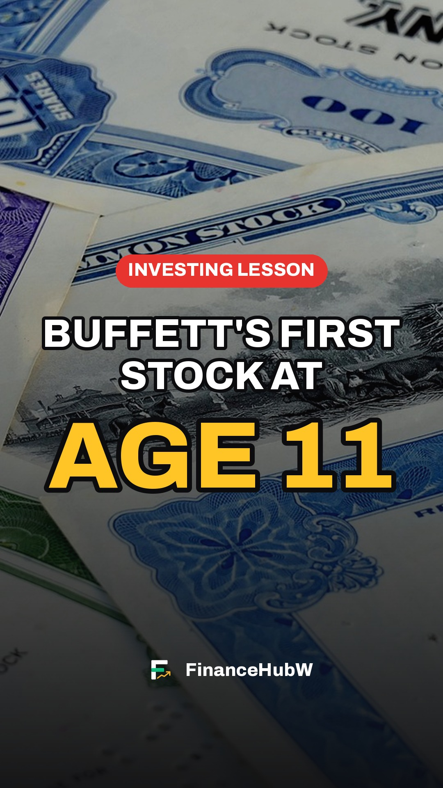</a> | **Warren Buffett's first stock taught him this** Money lesson · Money Basics | 26 Oct | 13 | 102% | [YouTube](https://youtube.com/shorts/dFxZ2gKHrn0) · [Video](https://github.com/financehubw/FinanceHubW/releases/download/shorts/buffett_age_11.mp4) |
| <a href="https://youtube.com/shorts/ILroImlP6go">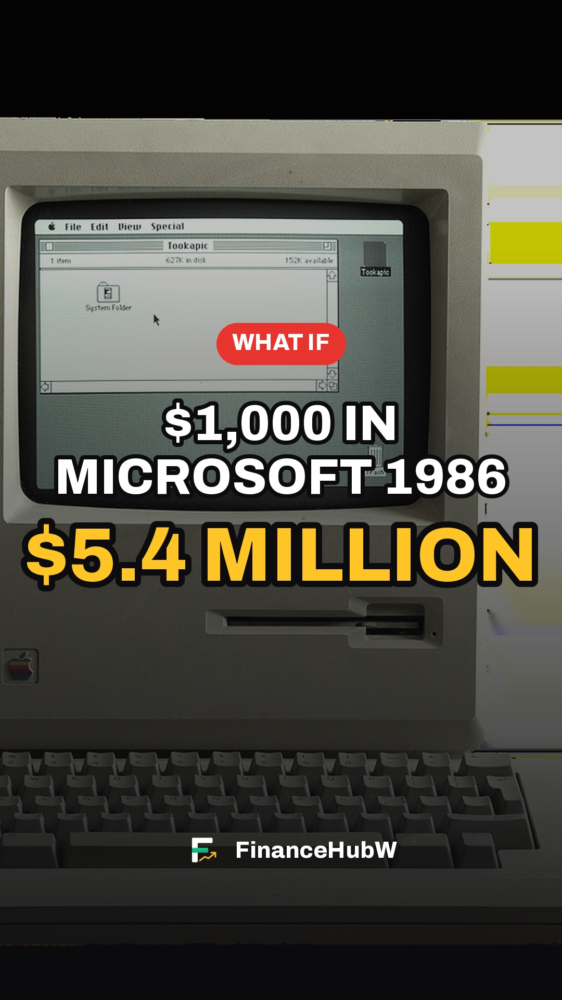</a> | **$1,000 in Microsoft's first trading day is now worth this** Data race · What If You Invested? | 26 Oct | 19 | 120% | [YouTube](https://youtube.com/shorts/ILroImlP6go) · [Video](https://github.com/financehubw/FinanceHubW/releases/download/shorts/microsoft_ipo.mp4) |
| <a href="https://youtube.com/shorts/2oHmnrWN3H4">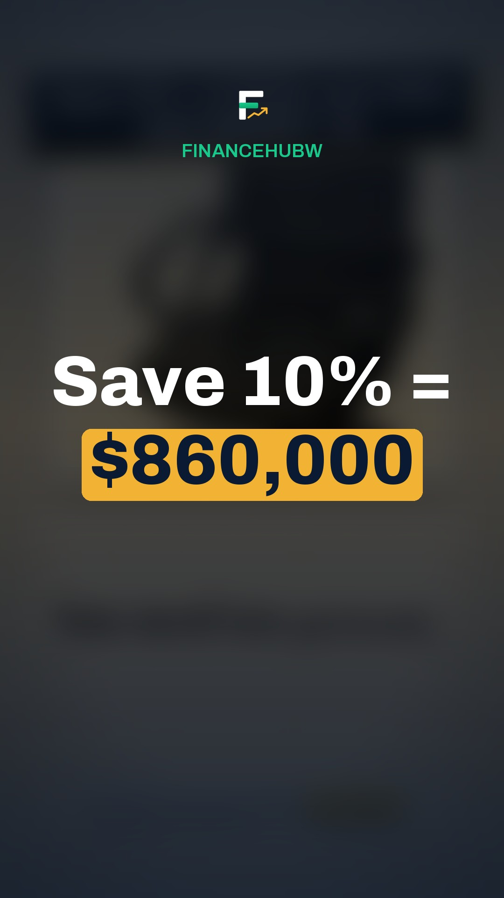</a> | **Save 10% and retire with $860,000** Money lesson · Money Basics | 25 Oct | 19 | 40% | [YouTube](https://youtube.com/shorts/2oHmnrWN3H4) · [Video](https://github.com/financehubw/FinanceHubW/releases/download/shorts/ten_percent_salary.mp4) |
| <a href="https://youtube.com/shorts/foeMNx2xc10">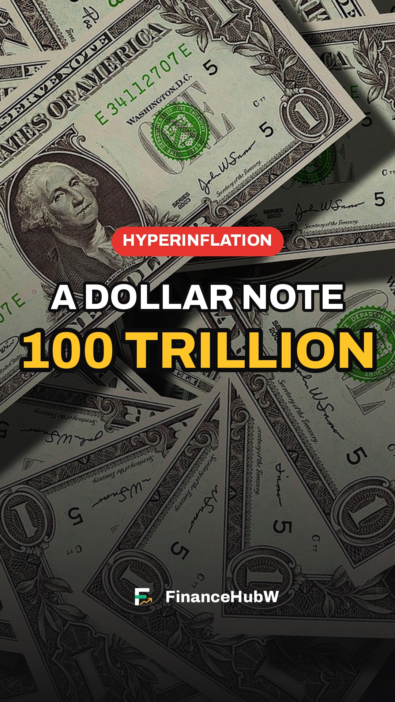</a> | **The 100 trillion dollar banknote** Money lesson · Money Basics | 22 Oct | 24 | 111% | [YouTube](https://youtube.com/shorts/foeMNx2xc10) · [Video](https://github.com/financehubw/FinanceHubW/releases/download/shorts/zimbabwe_100_trillion.mp4) |
| <a href="https://youtube.com/shorts/T-slk2ixlrI">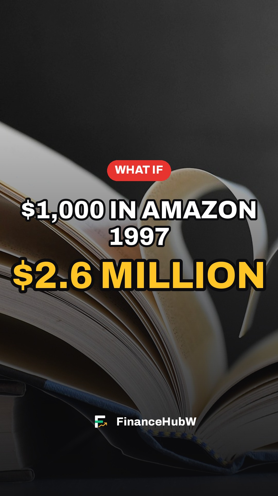</a> | **$1,000 in Amazon in 1997 is now worth this** Data race · What If You Invested? | 22 Oct | 13 | 32% | [YouTube](https://youtube.com/shorts/T-slk2ixlrI) · [Video](https://github.com/financehubw/FinanceHubW/releases/download/shorts/amazon_1997.mp4) |
| <a href="https://youtube.com/shorts/zdkxDvl4iFo">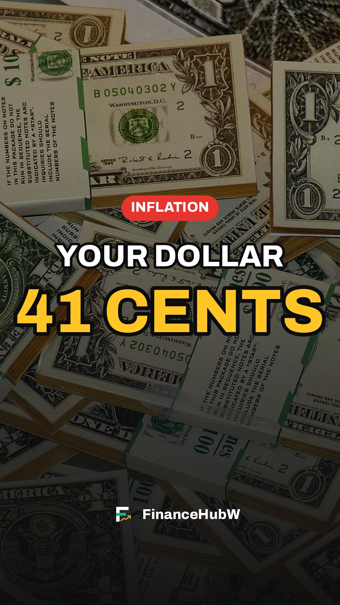</a> | **Why your dollar will be worth 41 cents** Money lesson · Money Basics | 21 Oct | 46 | 63% | [YouTube](https://youtube.com/shorts/zdkxDvl4iFo) · [Video](https://github.com/financehubw/FinanceHubW/releases/download/shorts/dollar_41_cents.mp4) |
| <a href="https://youtube.com/shorts/Es8bf9MbWKs">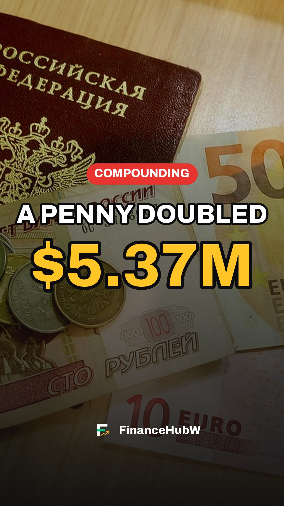</a> | **A penny doubled for 30 days vs $1 million** Money lesson · Money Basics | 21 Oct | 36 | 101% | [YouTube](https://youtube.com/shorts/Es8bf9MbWKs) · [Video](https://github.com/financehubw/FinanceHubW/releases/download/shorts/penny_doubling.mp4) |
| <a href="https://youtube.com/shorts/0mWiSY_ziw8">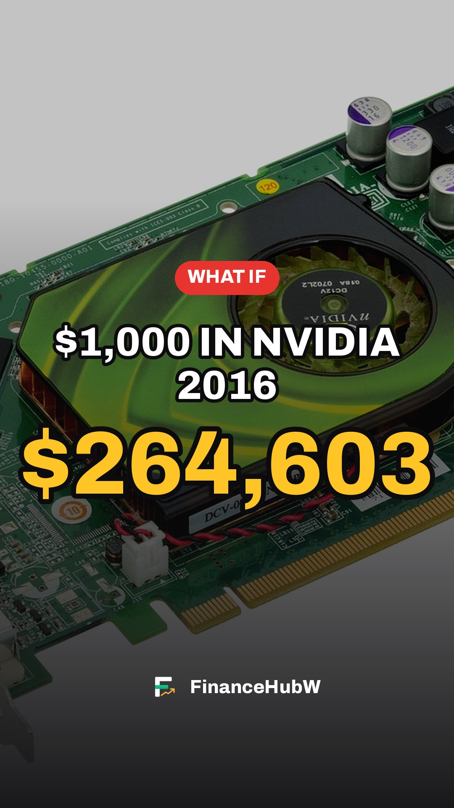</a> | **$1,000 in Nvidia in 2016 is now worth this** Data race · What If You Invested? | 20 Oct | 25 | 40% | [YouTube](https://youtube.com/shorts/0mWiSY_ziw8) · [Video](https://github.com/financehubw/FinanceHubW/releases/download/shorts/nvidia_2016.mp4) |
| <a href="https://youtube.com/shorts/umkVPMMBWHk">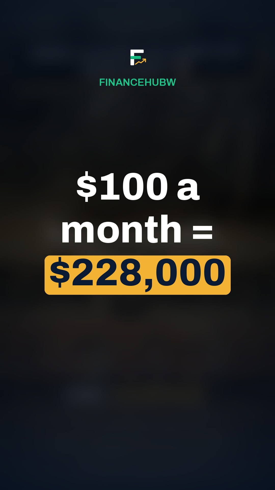</a> | **$100 a month could become $228,000** Money lesson · Money Basics | 20 Oct | 264 | 78% | [YouTube](https://youtube.com/shorts/umkVPMMBWHk) · [Video](https://github.com/financehubw/FinanceHubW/releases/download/shorts/hundred_a_month.mp4) |
| <a href="https://youtube.com/shorts/sh0-7SWR2bc">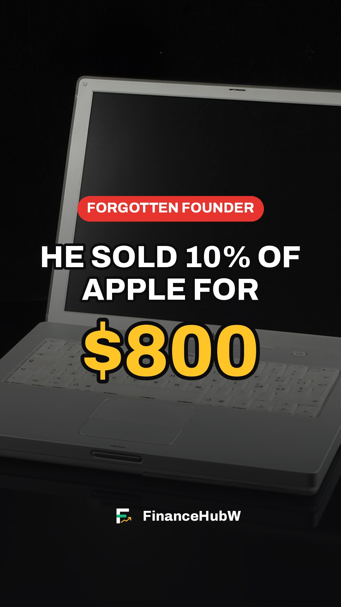</a> | **Apple's forgotten co-founder sold 10% for $800** Money lesson · Money Basics | 19 Oct | 2 | 16% | [YouTube](https://youtube.com/shorts/sh0-7SWR2bc) · [Video](https://github.com/financehubw/FinanceHubW/releases/download/shorts/ronald_wayne.mp4) |
|  | **The most expensive pizza ever bought** Money lesson · Money Basics | 19 Oct | 26 | 71% | [YouTube](https://youtube.com/shorts/2oHoMvAixbE) · [Video](https://github.com/financehubw/FinanceHubW/releases/download/shorts/bitcoin_pizza.mp4) |
|  | **Buffett's secret nobody talks about** Money lesson · Money Basics | 18 Oct | 1,040 | 76% | [YouTube](https://youtube.com/shorts/Zes-1A7ubsw) · [Video](https://github.com/financehubw/FinanceHubW/releases/download/shorts/buffett_after_65.mp4) |
| <a href="https://youtube.com/shorts/kOdjU6X2fjw">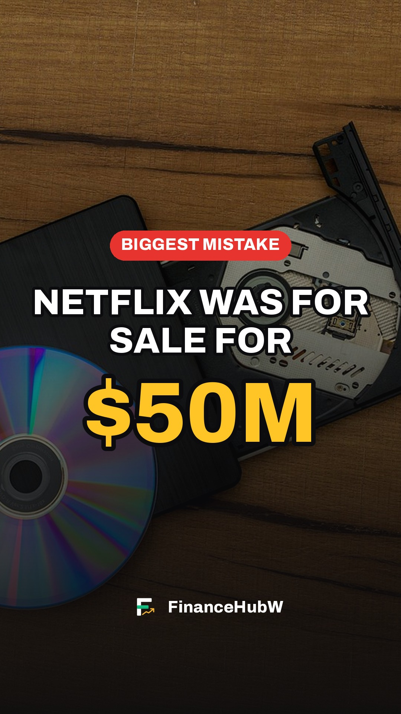</a> | **Blockbuster could have bought Netflix for $50 million** Money lesson · Money Basics | 17 Oct | 1 | 0% | [YouTube](https://youtube.com/shorts/kOdjU6X2fjw) · [Video](https://github.com/financehubw/FinanceHubW/releases/download/shorts/netflix_blockbuster.mp4) |
|  | **The $5,000 debt that lasts 20 years** Money lesson · Money Basics | 16 Oct | 32 | 34% | [YouTube](https://youtube.com/shorts/0fvp4V_448w) · [Video](https://github.com/financehubw/FinanceHubW/releases/download/shorts/credit_card_20_years.mp4) |
| <a href="https://youtube.com/shorts/em5KMILUGl0">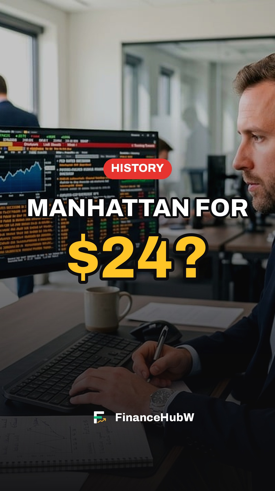</a> | **The worst deal in history?** Money lesson · Money Basics | 15 Oct | 271 | 68% | [YouTube](https://youtube.com/shorts/em5KMILUGl0) · [Video](https://github.com/financehubw/FinanceHubW/releases/download/shorts/manhattan_real.mp4) |
| <a href="https://youtube.com/shorts/kWeIUBxcdy4">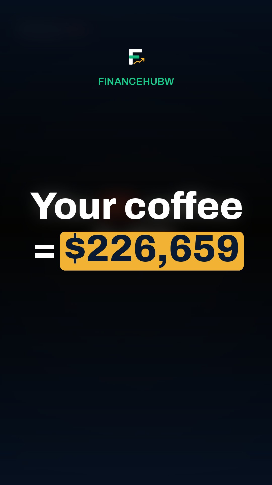</a> | **Your $5 coffee could be worth $226,659** Money lesson · Money Basics | 14 Oct | 2 | 95% | [YouTube](https://youtube.com/shorts/kWeIUBxcdy4) · [Video](https://github.com/financehubw/FinanceHubW/releases/download/shorts/m4_five_dollar_coffee.mp4) |
|  | **When bread cost 200 billion marks** Money lesson · Money Basics | 13 Oct | 22 | 61% | [YouTube](https://youtube.com/shorts/rs7xO5MRc3U) · [Video](https://github.com/financehubw/FinanceHubW/releases/download/shorts/bread_billion_marks.mp4) |
|  | **Your bank pays you 0.5% and charges you 20%** Money lesson · Money Basics | 12 Oct | 78 | 67% | [YouTube](https://youtube.com/shorts/757-gKWyCDQ) · [Video](https://github.com/financehubw/FinanceHubW/releases/download/shorts/bank_spread.mp4) |
|  | **Start investing at 20 or 30? The gap is $298,066** Money lesson · Money Basics | 11 Oct | 100 | 63% | [YouTube](https://youtube.com/shorts/rQPTKTejUpM) · [Video](https://github.com/financehubw/FinanceHubW/releases/download/shorts/m1_ten_year_head_start.mp4) |
| <a href="https://youtube.com/shorts/yNfP99LSP4E">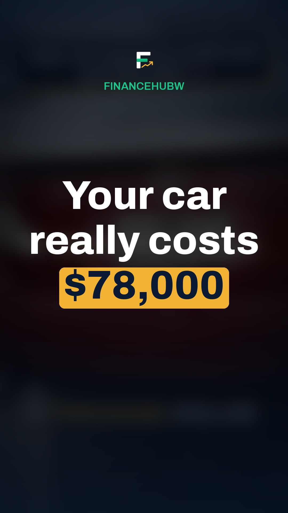</a> | **Your car payment could cost you $78,000** Money lesson · Money Basics | 10 Oct | 473 | 52% | [YouTube](https://youtube.com/shorts/yNfP99LSP4E) · [Video](https://github.com/financehubw/FinanceHubW/releases/download/shorts/car_payment.mp4) |
