# Shorts catalog

Every Short FinanceHubW has published, newest first: 109 so far, 49,947 YouTube views in total.
Views and watch-through (the average share of the Short that people watch) come from the YouTube Data and Analytics
APIs and refresh daily. Each video file is kept in the [`shorts` release](../../releases/tag/shorts).

_Updated 23 Nov 2026, 04:02 UTC by [`social/archive_shorts.py`](social/archive_shorts.py)._

| Cover | Short | Posted | Views | Watched | Links |
|---|---|---|--:|--:|---|
|  | **Home Depot vs Lowe's: $1,000 in 2010, who wins?** Data race · Head to Head | 22 Nov | 12 |  | [YouTube](https://youtube.com/shorts/SyuZFnOULCI) · [Video](https://github.com/financehubw/FinanceHubW/releases/download/shorts/vs_hd_low_2010.mp4) |
|  | **Powell, Nov 2022: Path to a soft landing has narrowed** Real footage · Fed Watch | 22 Nov | 769 |  | [YouTube](https://youtube.com/shorts/2VYVt0ZGEWw) · [Video](https://github.com/financehubw/FinanceHubW/releases/download/shorts/clip_fomc_20221102_2.mp4) |
| <a href="https://youtube.com/shorts/nBIa8CNB1CY">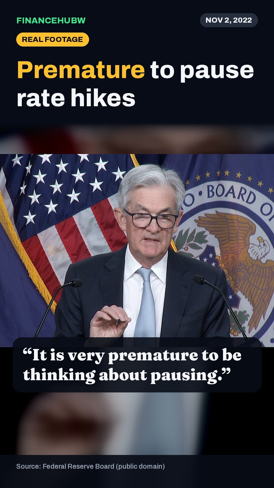</a> | **Powell, Nov 2022: Very premature to think about pausing rate hikes** Real footage · Fed Watch | 22 Nov | 228 |  | [YouTube](https://youtube.com/shorts/nBIa8CNB1CY) · [Video](https://github.com/financehubw/FinanceHubW/releases/download/shorts/clip_fomc_20221102_1.mp4) |
| <a href="https://youtube.com/shorts/2u61RdbD4Pc">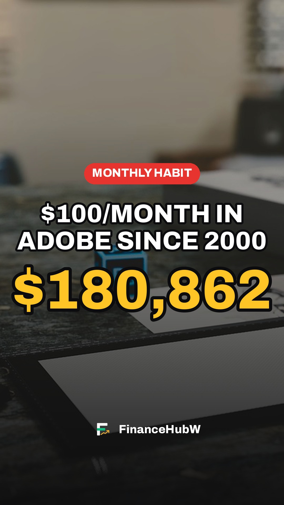</a> | **$100 a month into Adobe since 2000 is now worth this** Data race · What If You Invested? | 22 Nov | 24 |  | [YouTube](https://youtube.com/shorts/2u61RdbD4Pc) · [Video](https://github.com/financehubw/FinanceHubW/releases/download/shorts/monthly_adbe_2000.mp4) |
| <a href="https://youtube.com/shorts/O4OsaIPp9y0">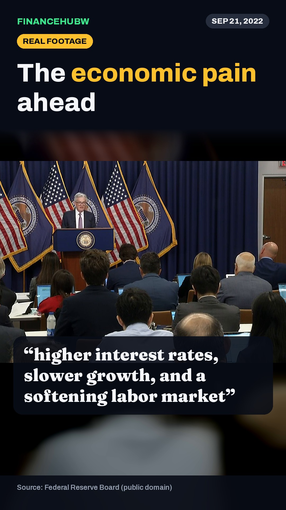</a> | **Powell, Sep 2022: Higher rates and slower growth cause economic pain** Real footage · Fed Watch | 22 Nov | 98 |  | [YouTube](https://youtube.com/shorts/O4OsaIPp9y0) · [Video](https://github.com/financehubw/FinanceHubW/releases/download/shorts/clip_fomc_20220921_2.mp4) |
|  | **Powell, Sep 2022: There is no painless way to lower inflation** Real footage · Fed Watch | 21 Nov | 925 |  | [YouTube](https://youtube.com/shorts/w0aZ7Sz8NKQ) · [Video](https://github.com/financehubw/FinanceHubW/releases/download/shorts/clip_fomc_20220921_1.mp4) |
| <a href="https://youtube.com/shorts/mCngp94mPmk">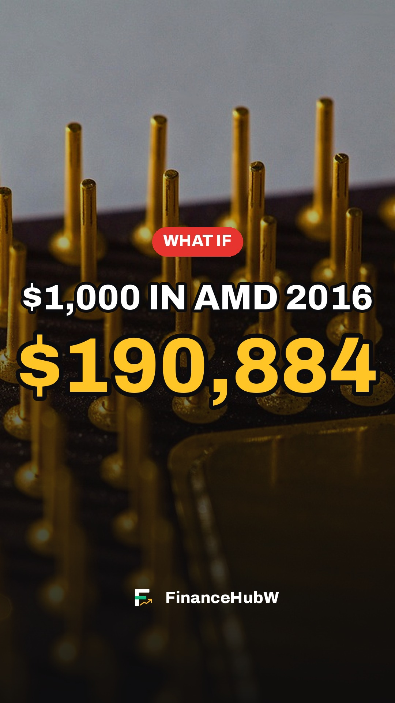</a> | **$1,000 in AMD in 2016 is now worth this** Data race · What If You Invested? | 21 Nov | 27 |  | [YouTube](https://youtube.com/shorts/mCngp94mPmk) · [Video](https://github.com/financehubw/FinanceHubW/releases/download/shorts/whatif_amd_2016.mp4) |
| <a href="https://youtube.com/shorts/iU-6Jcs0sWw">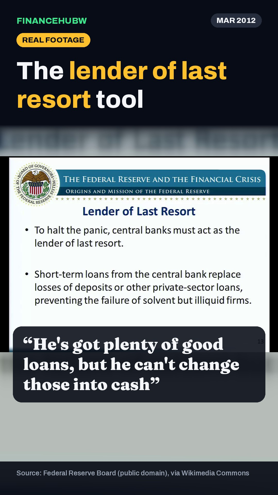</a> | **Chairman Bernanke: How the lender of last resort works** Real footage · Fed Watch | 21 Nov | 125 |  | [YouTube](https://youtube.com/shorts/iU-6Jcs0sWw) · [Video](https://github.com/financehubw/FinanceHubW/releases/download/shorts/clip_bernanke_lecture_1_3.mp4) |
| <a href="https://youtube.com/shorts/tm7mLLhkFLQ">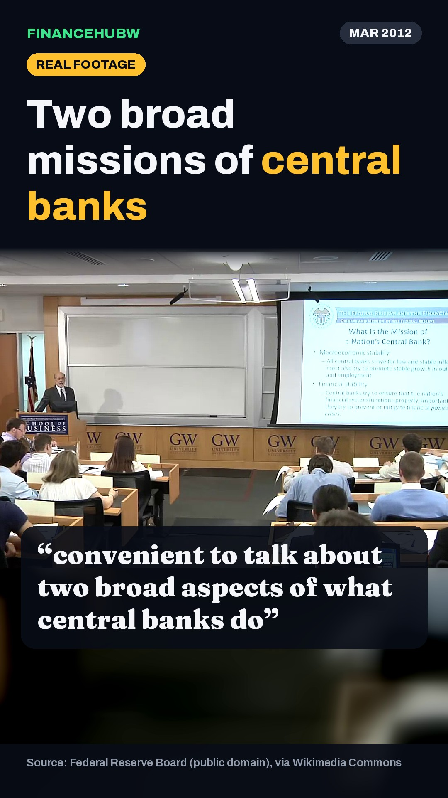</a> | **Chairman Bernanke: Two broad missions of central banks** Real footage · Fed Watch | 21 Nov | 166 |  | [YouTube](https://youtube.com/shorts/tm7mLLhkFLQ) · [Video](https://github.com/financehubw/FinanceHubW/releases/download/shorts/clip_bernanke_lecture_1_2.mp4) |
| <a href="https://youtube.com/shorts/fNDw-hwVp5g">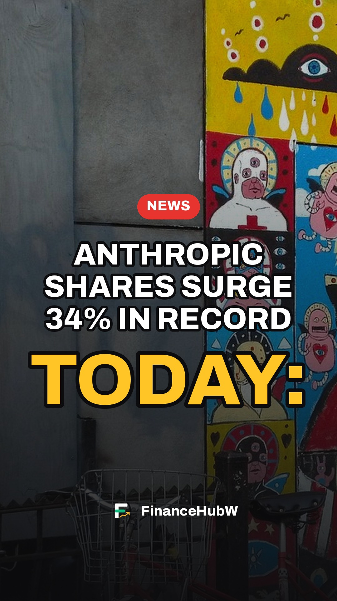</a> | **Anthropic shares surge 34% in record nasdaq IPO (today's money news)** Money news · Today's Money News | 20 Nov | 29 | 43% | [YouTube](https://youtube.com/shorts/fNDw-hwVp5g) · [Video](https://github.com/financehubw/FinanceHubW/releases/download/shorts/news_20261120.mp4) |
|  | **Google vs Meta: $1,000 in 2013, who wins?** Data race · Head to Head | 20 Nov | 45 | 73% | [YouTube](https://youtube.com/shorts/emtp1zxd_g0) · [Video](https://github.com/financehubw/FinanceHubW/releases/download/shorts/vs_googl_meta_2013.mp4) |
| <a href="https://youtube.com/shorts/1FilavureBU">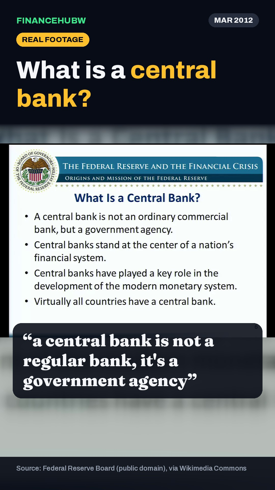</a> | **Chairman Bernanke: What is a central bank?** Real footage · Fed Watch | 20 Nov | 101 | 59% | [YouTube](https://youtube.com/shorts/1FilavureBU) · [Video](https://github.com/financehubw/FinanceHubW/releases/download/shorts/clip_bernanke_lecture_1_1.mp4) |
| <a href="https://youtube.com/shorts/OIc5UhQByCc">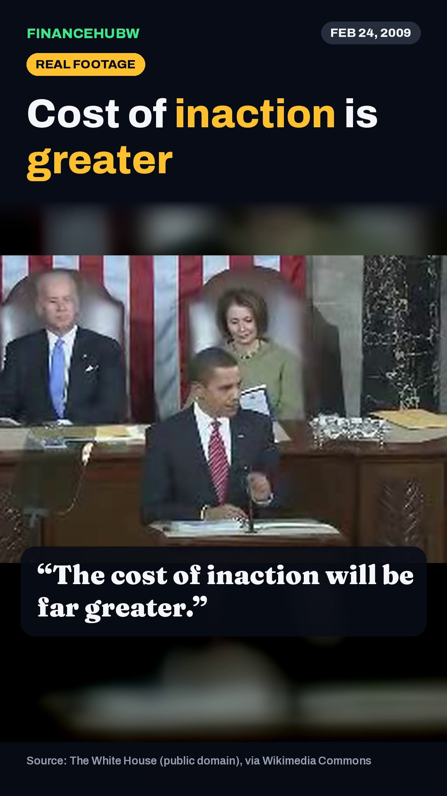</a> | **Obama, 2009: What is the true cost of economic inaction?** Real footage · Money History, in Real Footage | 20 Nov | 884 | 75% | [YouTube](https://youtube.com/shorts/OIc5UhQByCc) · [Video](https://github.com/financehubw/FinanceHubW/releases/download/shorts/clip_obama_2009_joint_2.mp4) |
|  | **$1,000 in each since 2008: who wins?** Data race · Head to Head | 20 Nov | 71 | 58% | [YouTube](https://youtube.com/shorts/CLdAktRxrO0) · [Video](https://github.com/financehubw/FinanceHubW/releases/download/shorts/race_safe_havens_2008.mp4) |
| <a href="https://youtube.com/shorts/OFZ9UPC9SPQ">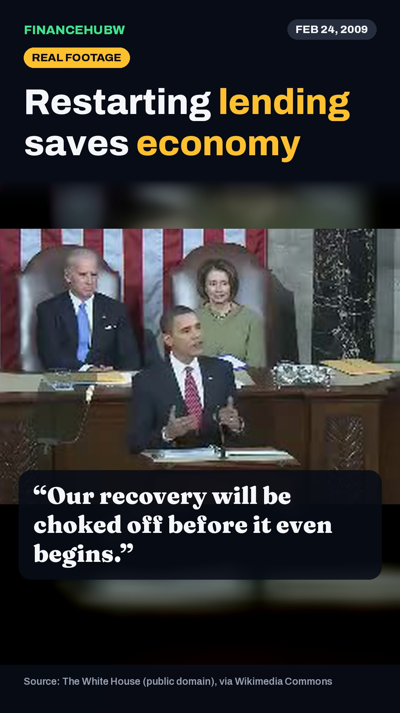</a> | **Obama, 2009: Why must we restart lending during the crisis?** Real footage · Money History, in Real Footage | 19 Nov | 1,374 | 76% | [YouTube](https://youtube.com/shorts/OFZ9UPC9SPQ) · [Video](https://github.com/financehubw/FinanceHubW/releases/download/shorts/clip_obama_2009_joint_1.mp4) |
| <a href="https://youtube.com/shorts/f3qAnUogcyY">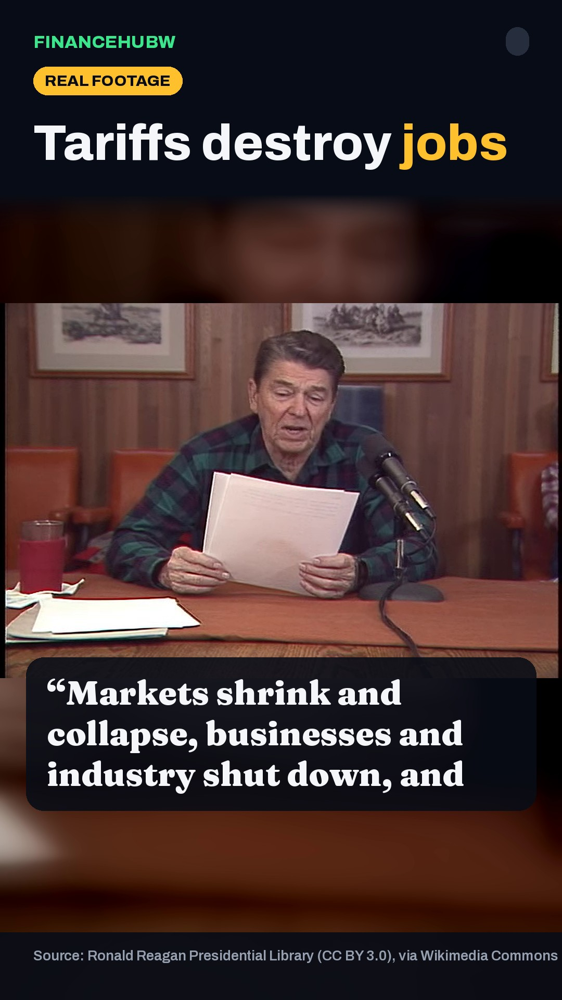</a> | **President Ronald Reagan: 1987 speech on how tariffs hurt markets** Real footage · Money History, in Real Footage | 19 Nov | 748 | 99% | [YouTube](https://youtube.com/shorts/f3qAnUogcyY) · [Video](https://github.com/financehubw/FinanceHubW/releases/download/shorts/clip_reagan_trade_2.mp4) |
|  | **Gold vs the S&P 500: $1,000 in 2000, who wins?** Data race · Head to Head | 19 Nov | 76 | 61% | [YouTube](https://youtube.com/shorts/almkdxfCoZE) · [Video](https://github.com/financehubw/FinanceHubW/releases/download/shorts/vs_gld_spy_2000.mp4) |
|  | **President Ronald Reagan: 1987 warning on tariffs and trade wars** Real footage · Money History, in Real Footage | 19 Nov | 347 | 81% | [YouTube](https://youtube.com/shorts/7hVcj52Y9nw) · [Video](https://github.com/financehubw/FinanceHubW/releases/download/shorts/clip_reagan_trade_1.mp4) |
| <a href="https://youtube.com/shorts/gGEIA_b5DOE">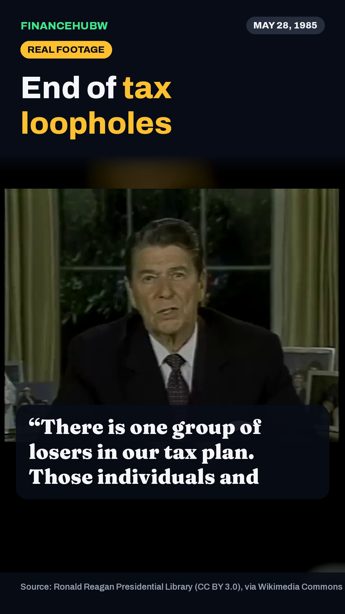</a> | **President Reagan, 1985: Why are tax system free rides ending?** Real footage · Money History, in Real Footage | 19 Nov | 1,736 | 76% | [YouTube](https://youtube.com/shorts/gGEIA_b5DOE) · [Video](https://github.com/financehubw/FinanceHubW/releases/download/shorts/clip_reagan_1985_tax_2.mp4) |
|  | **UK inflation rises to 3.6% (today's money news)** Money news · Today's Money News | 18 Nov | 16 | 35% | [YouTube](https://youtube.com/shorts/9ue5L-phIW4) · [Video](https://github.com/financehubw/FinanceHubW/releases/download/shorts/news_20261118.mp4) |
|  | **Your coffee could cost you nearly $1 million** Money lesson · Money Basics | 18 Nov | 3 | 0% | [YouTube](https://youtube.com/shorts/C8Zm-LiVFoI) · [Video](https://github.com/financehubw/FinanceHubW/releases/download/shorts/coffee_million.mp4) |
| <a href="https://youtube.com/shorts/mLr_yZMhawU">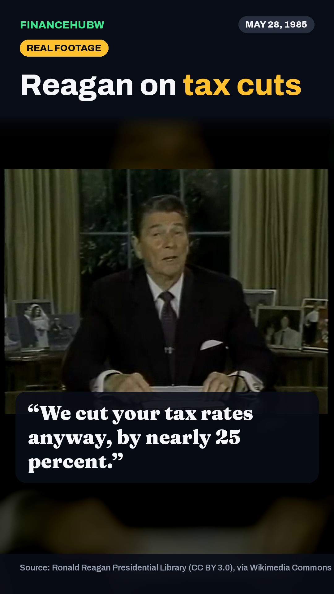</a> | **President Reagan, 1985: Did tax rate cuts trigger the economic expansion?** Real footage · Money History, in Real Footage | 18 Nov | 1,065 | 80% | [YouTube](https://youtube.com/shorts/mLr_yZMhawU) · [Video](https://github.com/financehubw/FinanceHubW/releases/download/shorts/clip_reagan_1985_tax_1.mp4) |
|  | **$1,000 in each since 2016: who wins?** Data race · Head to Head | 18 Nov | 13 | 191% | [YouTube](https://youtube.com/shorts/dhdTk5uzAQc) · [Video](https://github.com/financehubw/FinanceHubW/releases/download/shorts/race_chips_2016.mp4) |
|  | **Powell, Sep 2024: Is a half-point cut the new normal?** Real footage · Fed Watch | 18 Nov | 1,002 | 59% | [YouTube](https://youtube.com/shorts/mGqqtqysuDc) · [Video](https://github.com/financehubw/FinanceHubW/releases/download/shorts/clip_fomc_20240918_2.mp4) |
| <a href="https://youtube.com/shorts/umrF7U8jrfQ">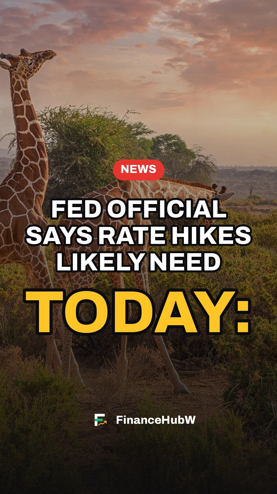</a> | **Fed official says rate hikes likely needed (today's money news)** Money news · Today's Money News | 17 Nov | 11 | 88% | [YouTube](https://youtube.com/shorts/umrF7U8jrfQ) · [Video](https://github.com/financehubw/FinanceHubW/releases/download/shorts/news_20261117.mp4) |
| <a href="https://youtube.com/shorts/LKqWxZIVv3A">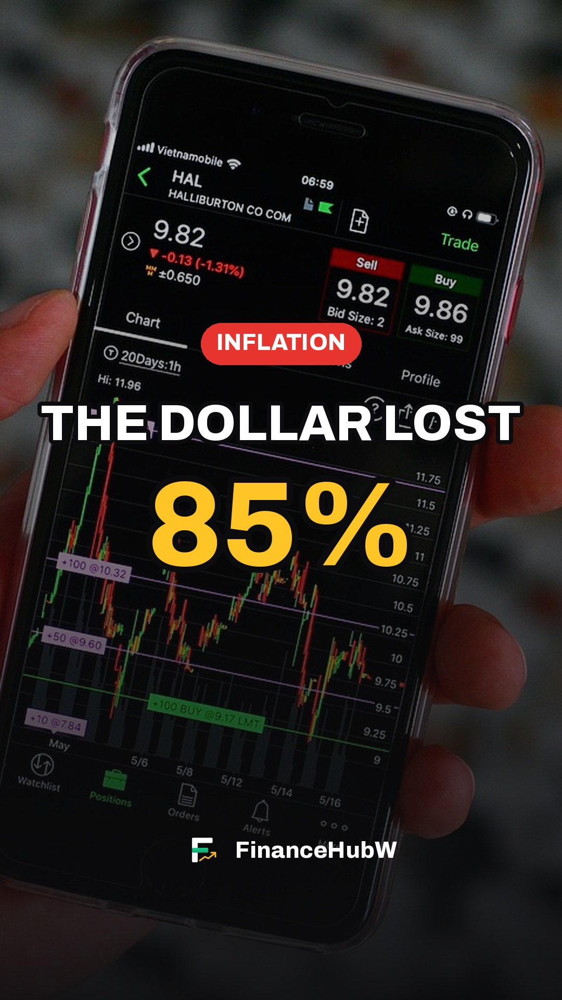</a> | **The dollar lost 85% since 1970** Money lesson · Money Basics | 17 Nov | 93 | 71% | [YouTube](https://youtube.com/shorts/LKqWxZIVv3A) · [Video](https://github.com/financehubw/FinanceHubW/releases/download/shorts/dollar_1970.mp4) |
| <a href="https://youtube.com/shorts/fJgniGe5Tus">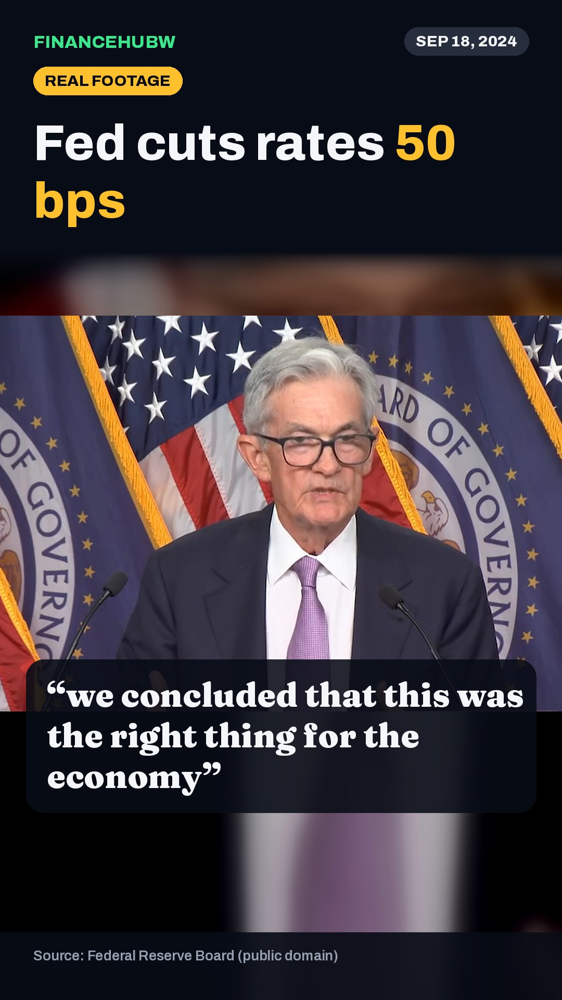</a> | **Powell, Sep 2024: Why a half-point rate cut now?** Real footage · Fed Watch | 17 Nov | 368 | 60% | [YouTube](https://youtube.com/shorts/fJgniGe5Tus) · [Video](https://github.com/financehubw/FinanceHubW/releases/download/shorts/clip_fomc_20240918_1.mp4) |
|  | **The one-second trick that tells you when your money doubles** Money lesson · Money Basics | 17 Nov | 4 | 108% | [YouTube](https://youtube.com/shorts/mRH1tk5s11s) · [Video](https://github.com/financehubw/FinanceHubW/releases/download/shorts/rule_of_72_global.mp4) |
|  | **Powell, Mar 2023: Have deposit flows stabilized across lenders?** Real footage · Fed Watch | 16 Nov | 3 | 0% | [YouTube](https://youtube.com/shorts/HJ7CkcjRDpI) · [Video](https://github.com/financehubw/FinanceHubW/releases/download/shorts/clip_fomc_20230322_2.mp4) |
|  | **Bitcoin vs Gold: $1,000 in 2016, who wins?** Data race · Head to Head | 16 Nov | 1 | 0% | [YouTube](https://youtube.com/shorts/J4HFcIi0B2c) · [Video](https://github.com/financehubw/FinanceHubW/releases/download/shorts/vs_btcusd_gld_2016.mp4) |
|  | **Powell, Mar 2023: Is the banking system sound after recent stress?** Real footage · Fed Watch | 16 Nov | 11 | 25% | [YouTube](https://youtube.com/shorts/Q93s3qrgHD0) · [Video](https://github.com/financehubw/FinanceHubW/releases/download/shorts/clip_fomc_20230322_1.mp4) |
|  | **$1,000 in each since 2010: who wins?** Data race · Head to Head | 15 Nov | 82 | 66% | [YouTube](https://youtube.com/shorts/bUaPEjNSdqk) · [Video](https://github.com/financehubw/FinanceHubW/releases/download/shorts/race_brands_2010.mp4) |
| <a href="https://youtube.com/shorts/Kgn4jKFFiCA">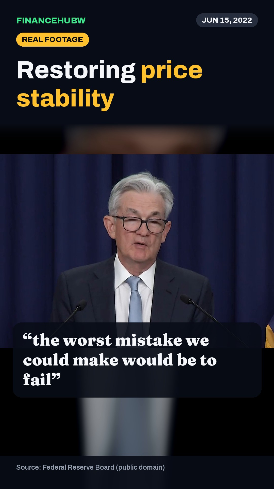</a> | **Powell, Jun 2022: Failing to lower inflation is not an option** Real footage · Fed Watch | 15 Nov | 988 | 38% | [YouTube](https://youtube.com/shorts/Kgn4jKFFiCA) · [Video](https://github.com/financehubw/FinanceHubW/releases/download/shorts/clip_fomc_20220615_2.mp4) |
|  | **What $1,000 becomes in 50 years** Money lesson · Money Basics | 15 Nov | 87 | 56% | [YouTube](https://youtube.com/shorts/HRij5YllozU) · [Video](https://github.com/financehubw/FinanceHubW/releases/download/shorts/one_thousand_fifty_years.mp4) |
| <a href="https://youtube.com/shorts/riuZMPaOess">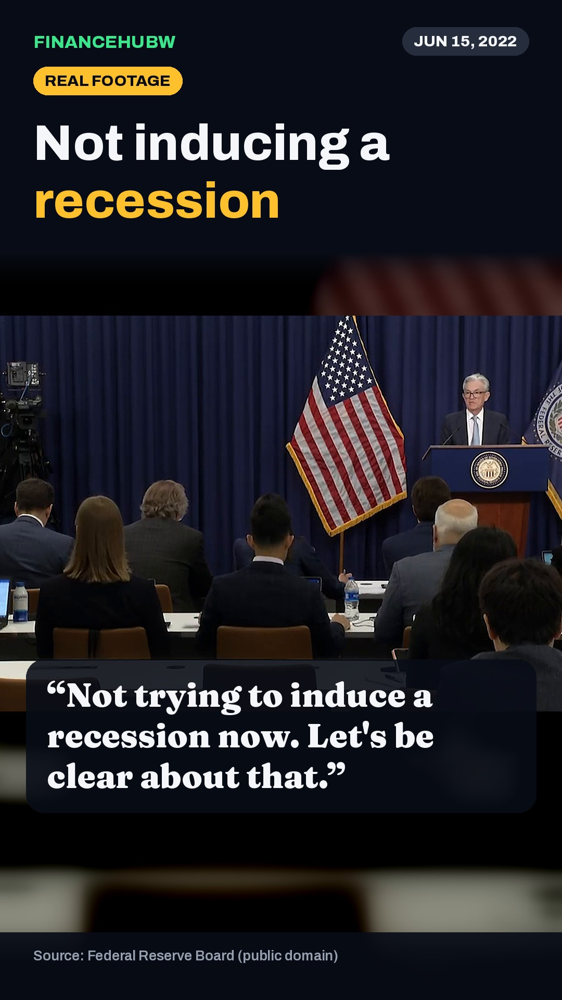</a> | **Powell, Jun 2022: We're not trying to induce a recession** Real footage · Fed Watch | 15 Nov | 1,087 | 44% | [YouTube](https://youtube.com/shorts/riuZMPaOess) · [Video](https://github.com/financehubw/FinanceHubW/releases/download/shorts/clip_fomc_20220615_1.mp4) |
|  | **How your money could grow 17x** Money lesson · Money Basics | 15 Nov | 31 | 27% | [YouTube](https://youtube.com/shorts/tcO1pHYsX9U) · [Video](https://github.com/financehubw/FinanceHubW/releases/download/shorts/doubling_17x.mp4) |
|  | **Powell, Mar 2020: Conduct monetary policy independently** Real footage · Fed Watch | 14 Nov | 105 | 23% | [YouTube](https://youtube.com/shorts/0jwpQesVFlA) · [Video](https://github.com/financehubw/FinanceHubW/releases/download/shorts/clip_fomc_20200315_2.mp4) |
|  | **3 money mistakes in your 40s you can still fix** Money lesson · Money Mistakes | 14 Nov | 88 | 83% | [YouTube](https://youtube.com/shorts/nlyrpYNHYWM) · [Video](https://github.com/financehubw/FinanceHubW/releases/download/shorts/mistakes_40s.mp4) |
|  | **Powell, Mar 2020: Economic outlook depends on virus spread** Real footage · Fed Watch | 14 Nov | 252 | 30% | [YouTube](https://youtube.com/shorts/w6VlTSNxGpI) · [Video](https://github.com/financehubw/FinanceHubW/releases/download/shorts/clip_fomc_20200315_1.mp4) |
|  | **Amazon vs Walmart: $1,000 in 2010, who wins?** Data race · Head to Head | 14 Nov | 101 | 48% | [YouTube](https://youtube.com/shorts/2LJp3UL9wKQ) · [Video](https://github.com/financehubw/FinanceHubW/releases/download/shorts/vs_amzn_wmt_2010.mp4) |
|  | **"The best investment in the world": 1941 US savings bonds** Real footage · Money History, in Real Footage | 14 Nov | 390 | 79% | [YouTube](https://youtube.com/shorts/CFSjBDy_91w) · [Video](https://github.com/financehubw/FinanceHubW/releases/download/shorts/clip_bonds41.mp4) |
|  | **3 money mistakes in your 30s that are hard to undo** Money lesson · Money Mistakes | 13 Nov | 66 | 50% | [YouTube](https://youtube.com/shorts/t49Uwn-ldvI) · [Video](https://github.com/financehubw/FinanceHubW/releases/download/shorts/mistakes_30s.mp4) |
| <a href="https://youtube.com/shorts/T47fznQt5Io">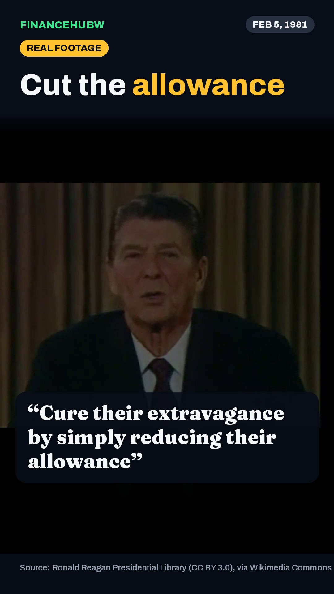</a> | **Reagan's famous "allowance" line about government spending (1981)** Real footage · Money History, in Real Footage | 13 Nov | 346 | 90% | [YouTube](https://youtube.com/shorts/T47fznQt5Io) · [Video](https://github.com/financehubw/FinanceHubW/releases/download/shorts/clip_reagan81_allowance.mp4) |
|  | **Start at 25 or 35? The 10-year gap · Compound Interest #3** Money lesson · Compound Interest, Explained | 13 Nov | 48 | 63% | [YouTube](https://youtube.com/shorts/fI2aN7uRhfg) · [Video](https://github.com/financehubw/FinanceHubW/releases/download/shorts/compound_3_start_early.mp4) |
|  | **What a $1,000 bank loan cost in 1947** Real footage · Money History, in Real Footage | 13 Nov | 1,399 | 87% | [YouTube](https://youtube.com/shorts/-dB0U05_Nm0) · [Video](https://github.com/financehubw/FinanceHubW/releases/download/shorts/clip_bank47_loan.mp4) |
|  | **Fed to skip rate vote in October 2027 (today's money news)** Money news · Today's Money News | 12 Nov | 51 | 51% | [YouTube](https://youtube.com/shorts/h06trBkfycA) · [Video](https://github.com/financehubw/FinanceHubW/releases/download/shorts/news_20261112.mp4) |
|  | **Real estate vs stocks: $10,000 in 2010, who won?** Data race · Head to Head | 12 Nov | 92 | 59% | [YouTube](https://youtube.com/shorts/xwAo9DVueJw) · [Video](https://github.com/financehubw/FinanceHubW/releases/download/shorts/realestate_vs_stocks.mp4) |
|  | **Reagan on the night his father lost his job (Great Depression)** Real footage · Money History, in Real Footage | 12 Nov | 1,360 | 85% | [YouTube](https://youtube.com/shorts/mxM_MXFUDFI) · [Video](https://github.com/financehubw/FinanceHubW/releases/download/shorts/clip_reagan82_depression.mp4) |
|  | **3 reasons you never have enough money** Money lesson · Money Basics | 12 Nov | 27 | 38% | [YouTube](https://youtube.com/shorts/XBmTRh1J0zU) · [Video](https://github.com/financehubw/FinanceHubW/releases/download/shorts/never_enough_money.mp4) |
|  | **Reagan, 1982: "Markets will go up and they will come down"** Real footage · Money History, in Real Footage | 12 Nov | 538 | 98% | [YouTube](https://youtube.com/shorts/pjeQE5bODvo) · [Video](https://github.com/financehubw/FinanceHubW/releases/download/shorts/clip_reagan82_markets.mp4) |
|  | **OPEC oil output nears pre-war level (today's money news)** Money news · Today's Money News | 11 Nov | 32 | 51% | [YouTube](https://youtube.com/shorts/nnY5A1giww8) · [Video](https://github.com/financehubw/FinanceHubW/releases/download/shorts/news_20261111.mp4) |
| <a href="https://youtube.com/shorts/9PSLhMSJLdU">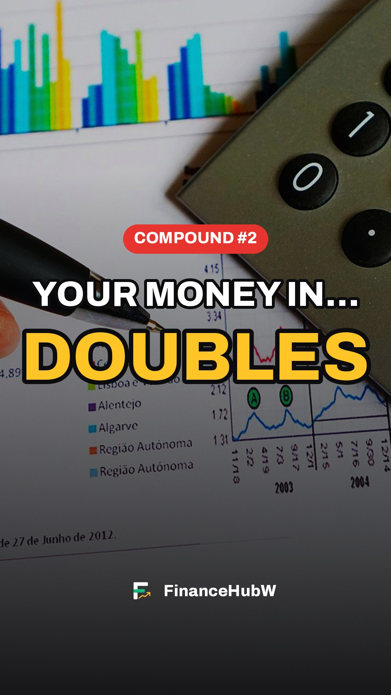</a> | **The rule of 72: how fast your money doubles · Compound Interest #2** Money lesson · Compound Interest, Explained | 11 Nov | 32 | 18% | [YouTube](https://youtube.com/shorts/9PSLhMSJLdU) · [Video](https://github.com/financehubw/FinanceHubW/releases/download/shorts/compound_2_rule72.mp4) |
|  | **Prices in 1947: a gallon of paint cost $2.98** Real footage · Money History, in Real Footage | 10 Nov | 329 | 67% | [YouTube](https://youtube.com/shorts/qra-B1eMmi4) · [Video](https://github.com/financehubw/FinanceHubW/releases/download/shorts/clip_paint47.mp4) |
| <a href="https://youtube.com/shorts/_0reUDS6vM4">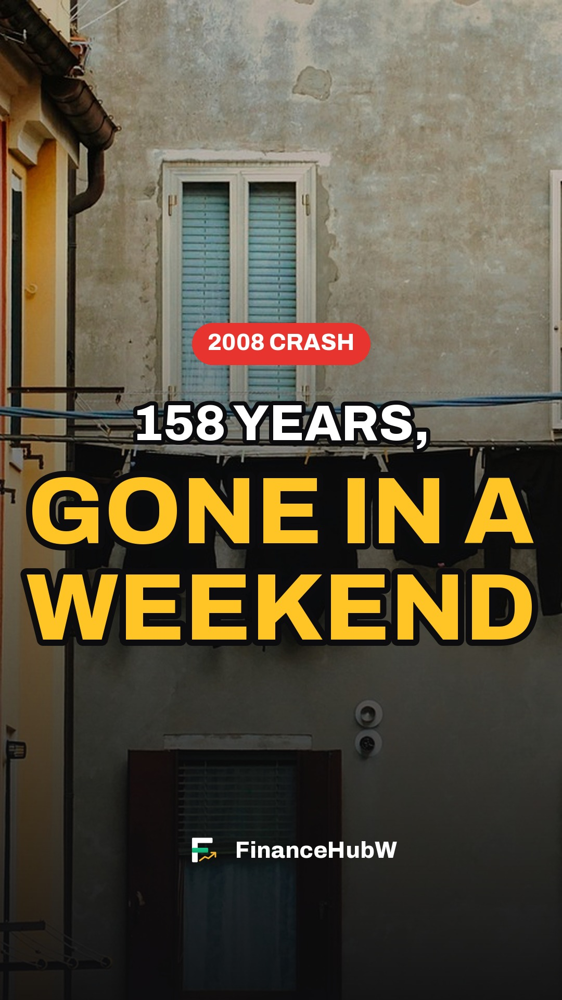</a> | **A 158-year-old bank collapsed in one weekend · Money Stories #10** Money story · Money Stories | 10 Nov | 33 | 15% | [YouTube](https://youtube.com/shorts/_0reUDS6vM4) · [Video](https://github.com/financehubw/FinanceHubW/releases/download/shorts/lehman_collapse.mp4) |
|  | **JFK explains his tax cut plan (1962 footage)** Real footage · Money History, in Real Footage | 10 Nov | 1,070 | 81% | [YouTube](https://youtube.com/shorts/U-9joXvQYkc) · [Video](https://github.com/financehubw/FinanceHubW/releases/download/shorts/clip_jfk62_taxcut.mp4) |
|  | **How much a day blows $10,000 a year?** Money lesson · Money Basics | 10 Nov | 65 | 49% | [YouTube](https://youtube.com/shorts/EkbQ6tmeDFo) · [Video](https://github.com/financehubw/FinanceHubW/releases/download/shorts/blow_10k_year.mp4) |
| <a href="https://youtube.com/shorts/El_OfTHnQyU">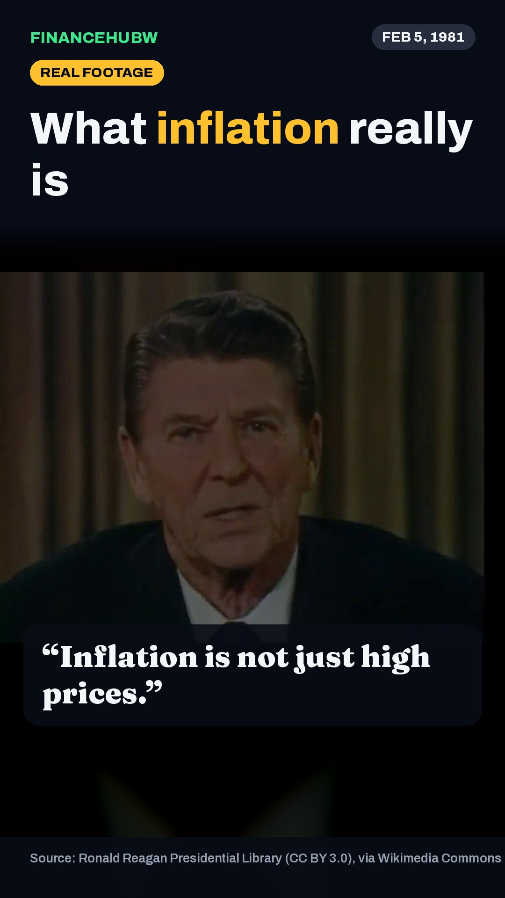</a> | **Reagan explains inflation in 14 seconds (1981)** Real footage · Money History, in Real Footage | 10 Nov | 1,120 | 87% | [YouTube](https://youtube.com/shorts/El_OfTHnQyU) · [Video](https://github.com/financehubw/FinanceHubW/releases/download/shorts/clip_reagan81_inflation.mp4) |
|  | **The 50/30/20 rule in 10 seconds** 10-second loop · Money Basics | 9 Nov | 85 | 101% | [YouTube](https://youtube.com/shorts/HjPrsUlRweA) · [Video](https://github.com/financehubw/FinanceHubW/releases/download/shorts/loop_50_30_20.mp4) |
|  | **FDR's first speech as president, during the 1933 bank panic** Real footage · Money History, in Real Footage | 9 Nov | 1,395 | 55% | [YouTube](https://youtube.com/shorts/aJQ1JZGvrNU) · [Video](https://github.com/financehubw/FinanceHubW/releases/download/shorts/clip_fdr33_action.mp4) |
| <a href="https://youtube.com/shorts/ffrZdrw-rf0">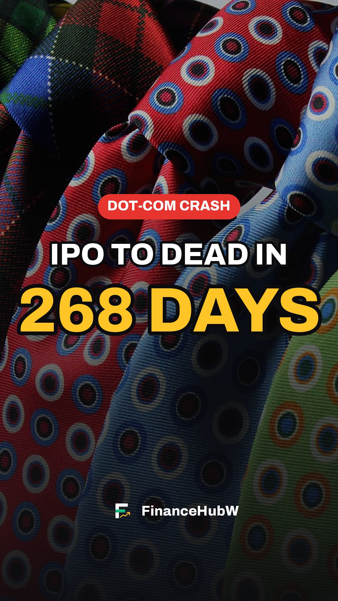</a> | **This company went from IPO to closed in 268 days · Money Stories #9** Money story · Money Stories | 9 Nov | 54 | 54% | [YouTube](https://youtube.com/shorts/ffrZdrw-rf0) · [Video](https://github.com/financehubw/FinanceHubW/releases/download/shorts/pets_com_crash.mp4) |
|  | **When oil prices quadrupled in 1973 (real 1975 film)** Real footage · Money History, in Real Footage | 9 Nov | 1,251 | 88% | [YouTube](https://youtube.com/shorts/Z3e6KDOoK08) · [Video](https://github.com/financehubw/FinanceHubW/releases/download/shorts/clip_oil73.mp4) |
|  | **The Rule of 72 in 10 seconds** 10-second loop · Money Basics | 8 Nov | 149 | 65% | [YouTube](https://youtube.com/shorts/vxpIpg17p5s) · [Video](https://github.com/financehubw/FinanceHubW/releases/download/shorts/loop_rule_of_72.mp4) |
|  | **How a 1947 film explained money (and what changed in 1971)** Real footage · Money History, in Real Footage | 8 Nov | 639 | 66% | [YouTube](https://youtube.com/shorts/g7yZiMNcFhI) · [Video](https://github.com/financehubw/FinanceHubW/releases/download/shorts/clip_money47_gold.mp4) |
|  | **How to invest in the S&P 500 (beginner, 30 seconds)** Money lesson · Money Basics | 8 Nov | 149 | 64% | [YouTube](https://youtube.com/shorts/lFeNNxqha8A) · [Video](https://github.com/financehubw/FinanceHubW/releases/download/shorts/sp500_beginners.mp4) |
| <a href="https://youtube.com/shorts/niYcJfFmCiI">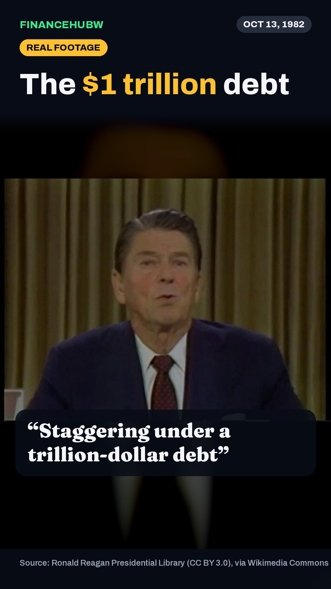</a> | **Reagan warned about a $1 trillion US debt in 1982** Real footage · Money History, in Real Footage | 8 Nov | 9,708 | 110% | [YouTube](https://youtube.com/shorts/niYcJfFmCiI) · [Video](https://github.com/financehubw/FinanceHubW/releases/download/shorts/clip_reagan82_debt.mp4) |
|  | **How much do you need to retire? The 25x rule** 10-second loop · Money Basics | 8 Nov | 128 | 110% | [YouTube](https://youtube.com/shorts/QMC1VKVXkn0) · [Video](https://github.com/financehubw/FinanceHubW/releases/download/shorts/loop_retire_25x.mp4) |
| <a href="https://youtube.com/shorts/Ly0PaMVa7_M">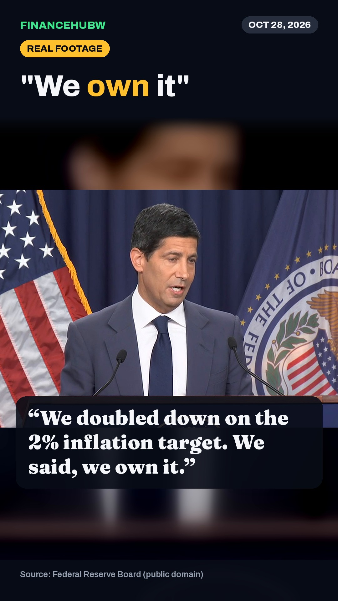</a> | **Fed Chair Warsh: "We own" the 2% inflation target** Real footage · Fed Watch | 7 Nov | 1,862 | 89% | [YouTube](https://youtube.com/shorts/Ly0PaMVa7_M) · [Video](https://github.com/financehubw/FinanceHubW/releases/download/shorts/clip_fomc_20261028_2.mp4) |
|  | **A secretary secretly built $9 million · Money Stories #8** Money story · Money Stories | 7 Nov | 159 | 45% | [YouTube](https://youtube.com/shorts/jTcVc7oNh3w) · [Video](https://github.com/financehubw/FinanceHubW/releases/download/shorts/secretary_millionaire.mp4) |
|  | **Gold was $33 an ounce in 1933 (real newsreel)** Real footage · Money History, in Real Footage | 7 Nov | 2,302 | 82% | [YouTube](https://youtube.com/shorts/plzfW_L_v3I) · [Video](https://github.com/financehubw/FinanceHubW/releases/download/shorts/clip_gold33.mp4) |
|  | **$7 a day could become $661,889** 10-second loop · Money Basics | 7 Nov | 209 | 100% | [YouTube](https://youtube.com/shorts/q6F3GK0qS4A) · [Video](https://github.com/financehubw/FinanceHubW/releases/download/shorts/loop_7_dollars_a_day.mp4) |
|  | **Compound interest explained in 20 seconds · Compound Interest #1** Money lesson · Compound Interest, Explained | 6 Nov | 244 | 48% | [YouTube](https://youtube.com/shorts/2c487mK0xTw) · [Video](https://github.com/financehubw/FinanceHubW/releases/download/shorts/compound_1_snowball.mp4) |
| <a href="https://youtube.com/shorts/cNuvUk5yHjI">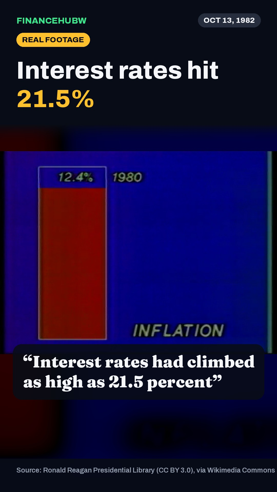</a> | **When US interest rates hit 21.5% (Reagan, 1982)** Real footage · Money History, in Real Footage | 6 Nov | 2,065 | 90% | [YouTube](https://youtube.com/shorts/cNuvUk5yHjI) · [Video](https://github.com/financehubw/FinanceHubW/releases/download/shorts/clip_reagan82_rates.mp4) |
| <a href="https://youtube.com/shorts/-C8VeufkIY4">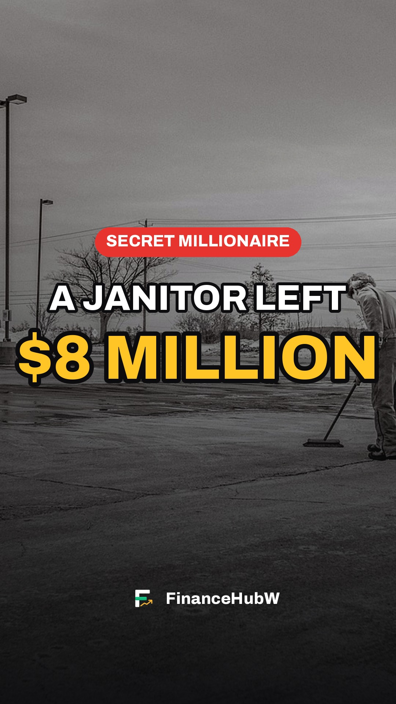</a> | **A janitor quietly left $8 million · Money Stories #7** Money story · Money Stories | 5 Nov | 52 | 79% | [YouTube](https://youtube.com/shorts/-C8VeufkIY4) · [Video](https://github.com/financehubw/FinanceHubW/releases/download/shorts/janitor_millionaire.mp4) |
| <a href="https://youtube.com/shorts/SIoj4UTQfH4">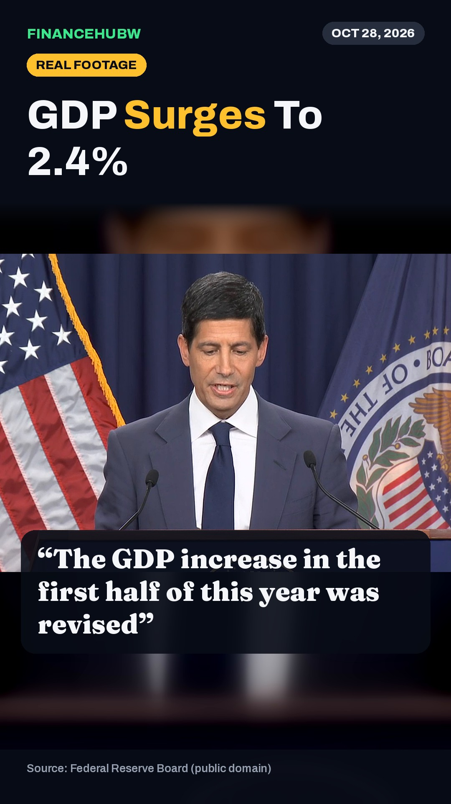</a> | **Fed Chair Warsh: Why not raise interest rates today?** Real footage · Fed Watch | 5 Nov | 1,245 | 49% | [YouTube](https://youtube.com/shorts/SIoj4UTQfH4) · [Video](https://github.com/financehubw/FinanceHubW/releases/download/shorts/clip_fomc_20261028_1.mp4) |
|  | **US stocks and Bitcoin surge after vote (today's money news)** Money news · Today's Money News | 4 Nov | 88 | 85% | [YouTube](https://youtube.com/shorts/KuVzYKh8lJQ) · [Video](https://github.com/financehubw/FinanceHubW/releases/download/shorts/news_20261104.mp4) |
| <a href="https://youtube.com/shorts/kGavwRgGC1E">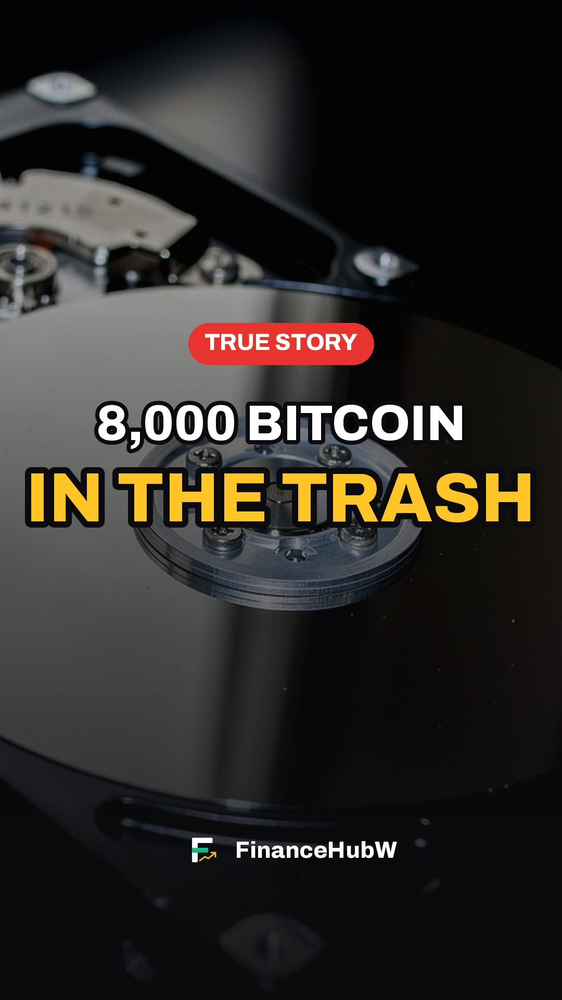</a> | **He threw away a hard drive with 8,000 bitcoin · Money Stories #6** Money story · Money Stories | 4 Nov | 70 | 63% | [YouTube](https://youtube.com/shorts/kGavwRgGC1E) · [Video](https://github.com/financehubw/FinanceHubW/releases/download/shorts/hard_drive_bitcoin.mp4) |
|  | **$500 a month can make you a millionaire** 10-second loop · Money Basics | 4 Nov | 5 | 0% | [YouTube](https://youtube.com/shorts/QTETFzWwr1c) · [Video](https://github.com/financehubw/FinanceHubW/releases/download/shorts/loop_500_a_month.mp4) |
|  | **US stocks rise as tech shares gain (today's money news)** Money news · Today's Money News | 3 Nov | 97 | 59% | [YouTube](https://youtube.com/shorts/6i3033fF3B4) · [Video](https://github.com/financehubw/FinanceHubW/releases/download/shorts/news_20261103.mp4) |
| <a href="https://youtube.com/shorts/wQ6Ed_6ahj8">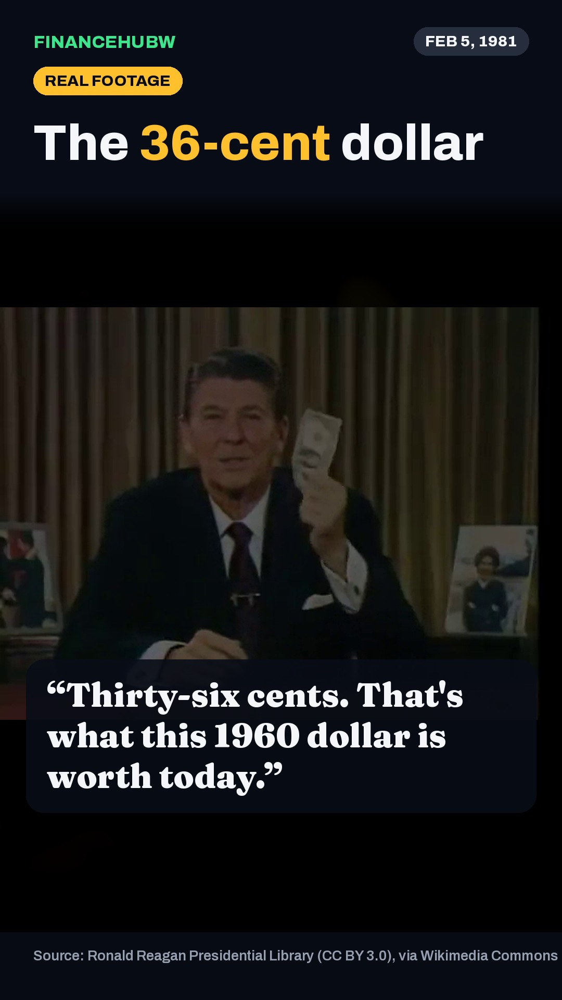</a> | **Reagan shows what inflation did to the dollar (1981)** Real footage · Money History, in Real Footage | 3 Nov | 4,274 | 101% | [YouTube](https://youtube.com/shorts/wQ6Ed_6ahj8) · [Video](https://github.com/financehubw/FinanceHubW/releases/download/shorts/clip_reagan81_36cents.mp4) |
|  | **How to split every paycheck (the 50/30/20 rule)** Money lesson · Money Basics | 3 Nov | 92 | 71% | [YouTube](https://youtube.com/shorts/B4YeM3XlOwk) · [Video](https://github.com/financehubw/FinanceHubW/releases/download/shorts/paycheck_split.mp4) |
|  | **One joke wiped out £500 million · Money Stories #5** Money story · Money Stories | 3 Nov | 195 | 77% | [YouTube](https://youtube.com/shorts/bd5aJuyjo8Y) · [Video](https://github.com/financehubw/FinanceHubW/releases/download/shorts/ratner_joke.mp4) |
|  | **3 money mistakes in your 20s that cost the most** Money lesson · Money Mistakes | 2 Nov | 35 | 49% | [YouTube](https://youtube.com/shorts/oBo8QbBT8Tw) · [Video](https://github.com/financehubw/FinanceHubW/releases/download/shorts/mistakes_20s.mp4) |
| <a href="https://youtube.com/shorts/4szkjKSn-jA">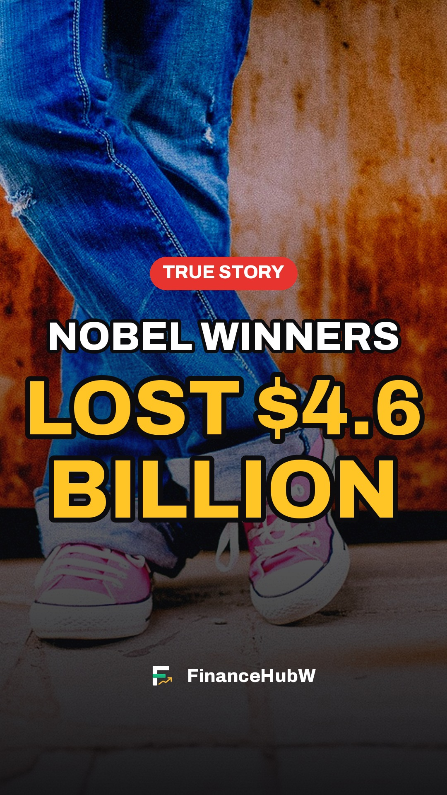</a> | **Nobel prize winners ran a fund that nearly broke Wall Street · Money Stories #4** Money story · Money Stories | 2 Nov | 67 | 56% | [YouTube](https://youtube.com/shorts/4szkjKSn-jA) · [Video](https://github.com/financehubw/FinanceHubW/releases/download/shorts/ltcm_nobel_fund.mp4) |
| <a href="https://youtube.com/shorts/vxDzuaNJulo">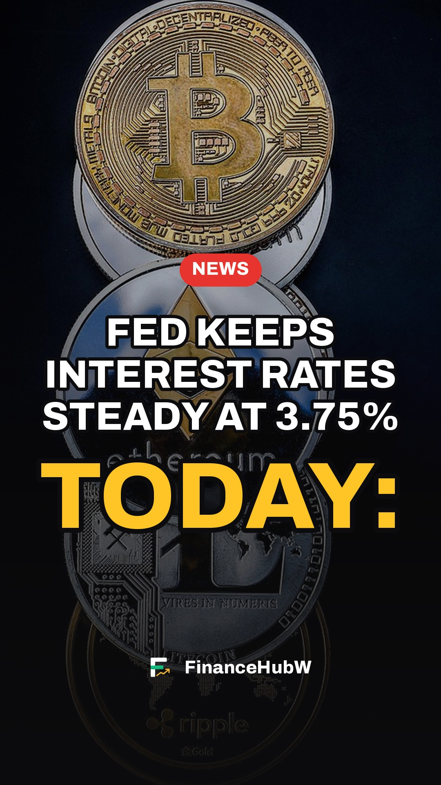</a> | **Fed keeps interest rates steady at 3.75% to 4% (today's money news)** Money news · Today's Money News | 29 Oct | 32 | 53% | [YouTube](https://youtube.com/shorts/vxDzuaNJulo) · [Video](https://github.com/financehubw/FinanceHubW/releases/download/shorts/news_20261029.mp4) |
|  | **Isaac Newton lost a fortune in a stock bubble · Money Stories #3** Money story · Money Stories | 29 Oct | 46 | 47% | [YouTube](https://youtube.com/shorts/aQ6DUSIjmxU) · [Video](https://github.com/financehubw/FinanceHubW/releases/download/shorts/newton_south_sea.mp4) |
|  | **He tried to buy a fighter jet with Pepsi points · Money Stories #2** Money story · Money Stories | 28 Oct | 133 | 91% | [YouTube](https://youtube.com/shorts/R0WZMF3ZNr4) · [Video](https://github.com/financehubw/FinanceHubW/releases/download/shorts/pepsi_harrier_jet.mp4) |
|  | **Kodak invented the digital camera, then went bankrupt · Money Stories #1** Money story · Money Stories | 28 Oct | 81 | 54% | [YouTube](https://youtube.com/shorts/fiddrA5mOqM) · [Video](https://github.com/financehubw/FinanceHubW/releases/download/shorts/kodak_digital_camera.mp4) |
| <a href="https://youtube.com/shorts/4qhcdQ8mtr8">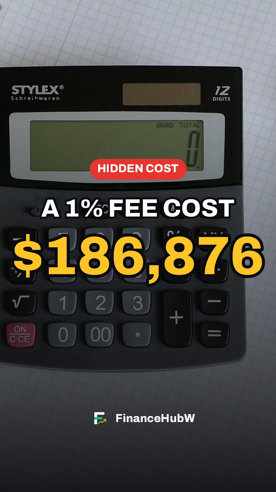</a> | **A 1% fee costs more than you think** Money lesson · Money Basics | 27 Oct | 95 | 72% | [YouTube](https://youtube.com/shorts/4qhcdQ8mtr8) · [Video](https://github.com/financehubw/FinanceHubW/releases/download/shorts/one_percent_fee.mp4) |
| <a href="https://youtube.com/shorts/-qTry0G9T1Y">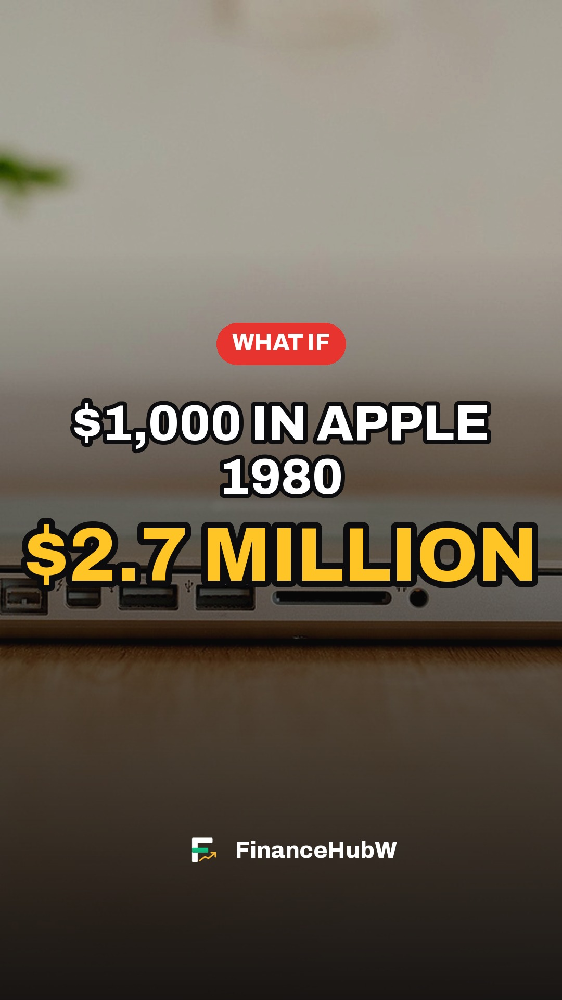</a> | **$1,000 in Apple's first trading day is now worth this** Data race · What If You Invested? | 27 Oct | 235 | 65% | [YouTube](https://youtube.com/shorts/-qTry0G9T1Y) · [Video](https://github.com/financehubw/FinanceHubW/releases/download/shorts/apple_ipo.mp4) |
|  | **Warren Buffett's first stock taught him this** Money lesson · Money Basics | 26 Oct | 13 | 102% | [YouTube](https://youtube.com/shorts/dFxZ2gKHrn0) · [Video](https://github.com/financehubw/FinanceHubW/releases/download/shorts/buffett_age_11.mp4) |
| <a href="https://youtube.com/shorts/ILroImlP6go">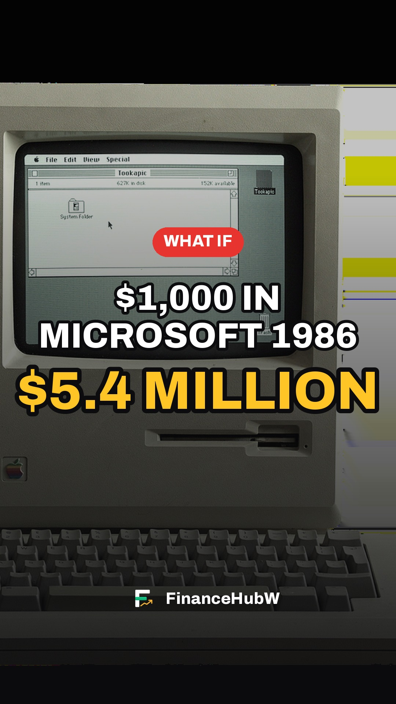</a> | **$1,000 in Microsoft's first trading day is now worth this** Data race · What If You Invested? | 26 Oct | 19 | 120% | [YouTube](https://youtube.com/shorts/ILroImlP6go) · [Video](https://github.com/financehubw/FinanceHubW/releases/download/shorts/microsoft_ipo.mp4) |
|  | **Save 10% and retire with $860,000** Money lesson · Money Basics | 25 Oct | 19 | 40% | [YouTube](https://youtube.com/shorts/2oHmnrWN3H4) · [Video](https://github.com/financehubw/FinanceHubW/releases/download/shorts/ten_percent_salary.mp4) |
| <a href="https://youtube.com/shorts/foeMNx2xc10">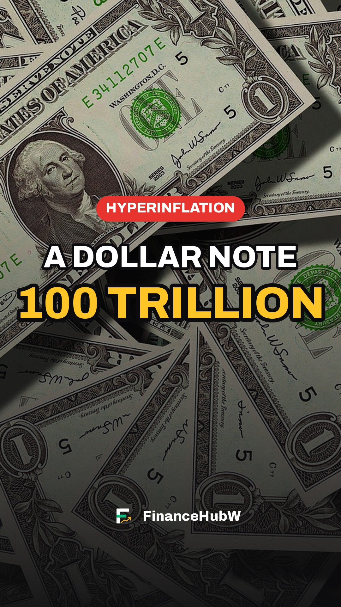</a> | **The 100 trillion dollar banknote** Money lesson · Money Basics | 22 Oct | 26 | 111% | [YouTube](https://youtube.com/shorts/foeMNx2xc10) · [Video](https://github.com/financehubw/FinanceHubW/releases/download/shorts/zimbabwe_100_trillion.mp4) |
| <a href="https://youtube.com/shorts/T-slk2ixlrI">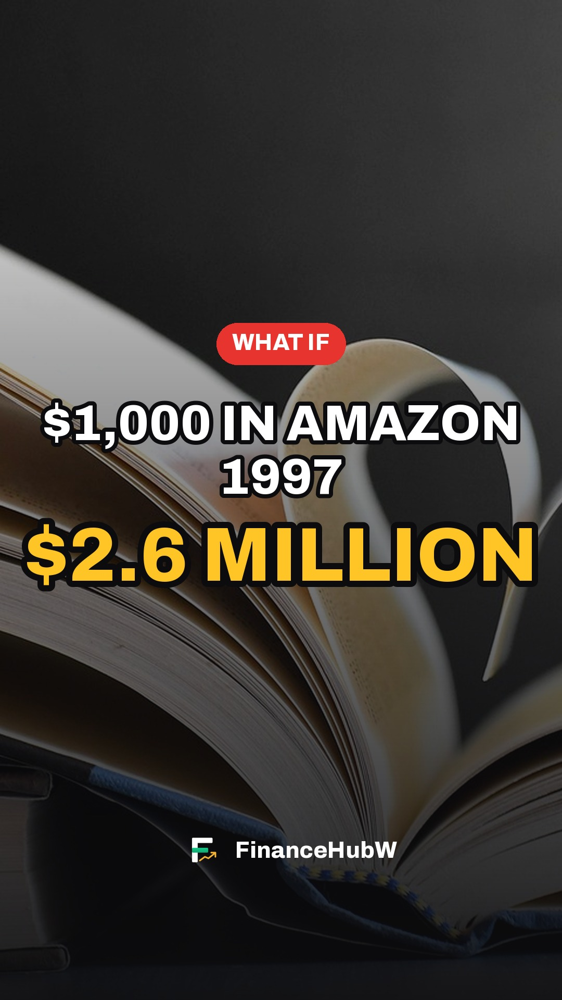</a> | **$1,000 in Amazon in 1997 is now worth this** Data race · What If You Invested? | 22 Oct | 14 | 32% | [YouTube](https://youtube.com/shorts/T-slk2ixlrI) · [Video](https://github.com/financehubw/FinanceHubW/releases/download/shorts/amazon_1997.mp4) |
| <a href="https://youtube.com/shorts/zdkxDvl4iFo">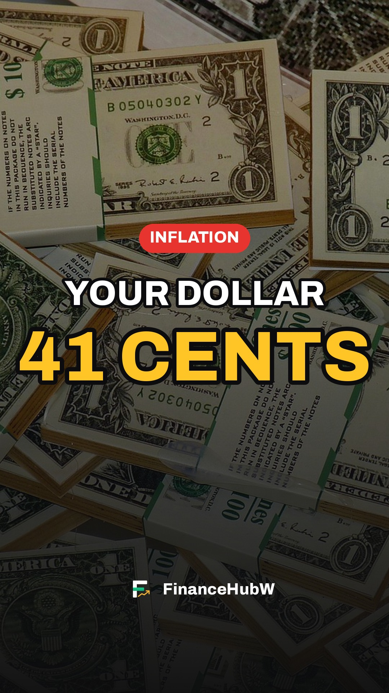</a> | **Why your dollar will be worth 41 cents** Money lesson · Money Basics | 21 Oct | 46 | 63% | [YouTube](https://youtube.com/shorts/zdkxDvl4iFo) · [Video](https://github.com/financehubw/FinanceHubW/releases/download/shorts/dollar_41_cents.mp4) |
| <a href="https://youtube.com/shorts/Es8bf9MbWKs">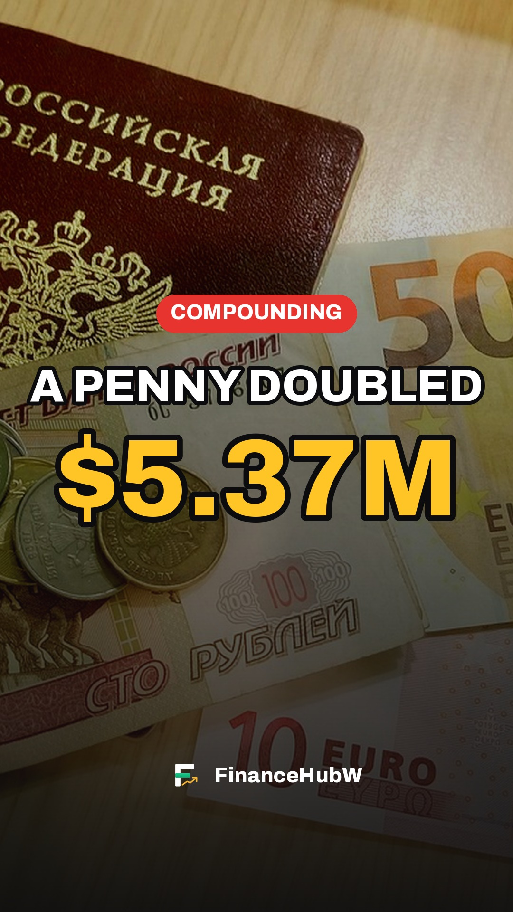</a> | **A penny doubled for 30 days vs $1 million** Money lesson · Money Basics | 21 Oct | 37 | 101% | [YouTube](https://youtube.com/shorts/Es8bf9MbWKs) · [Video](https://github.com/financehubw/FinanceHubW/releases/download/shorts/penny_doubling.mp4) |
| <a href="https://youtube.com/shorts/0mWiSY_ziw8">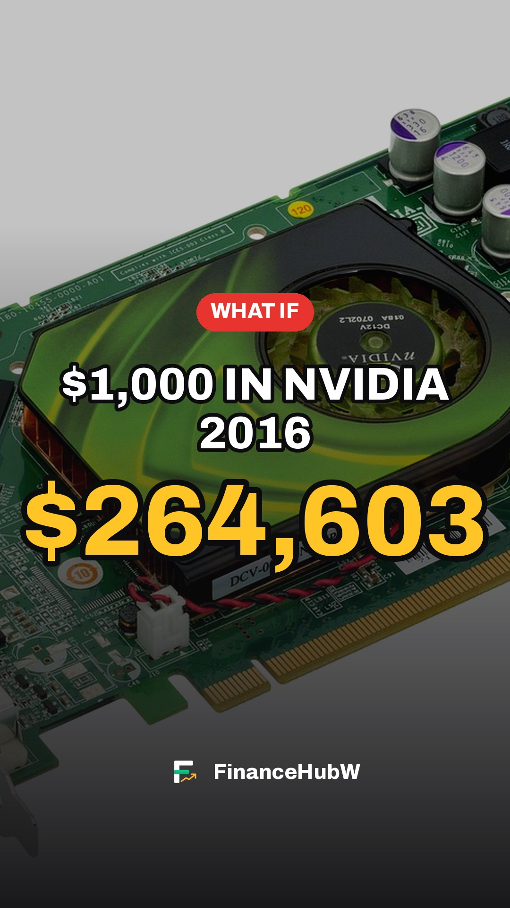</a> | **$1,000 in Nvidia in 2016 is now worth this** Data race · What If You Invested? | 20 Oct | 25 | 40% | [YouTube](https://youtube.com/shorts/0mWiSY_ziw8) · [Video](https://github.com/financehubw/FinanceHubW/releases/download/shorts/nvidia_2016.mp4) |
| <a href="https://youtube.com/shorts/umkVPMMBWHk">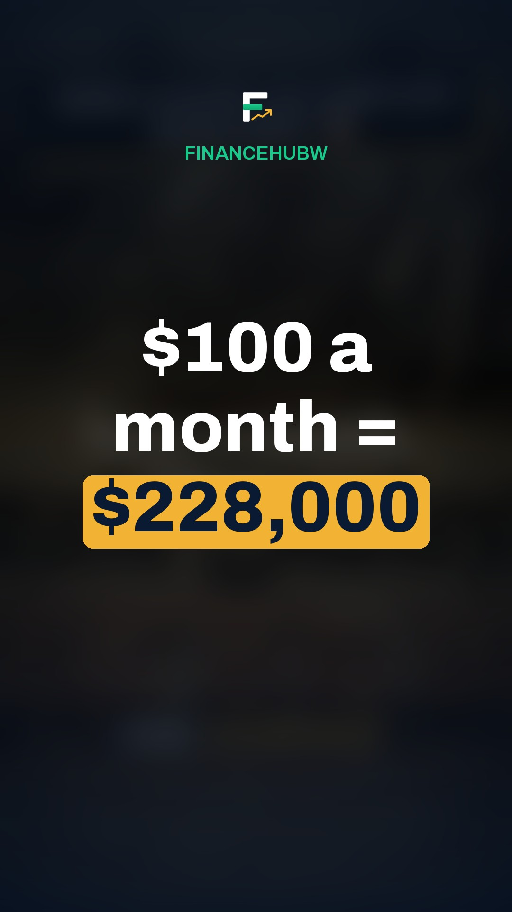</a> | **$100 a month could become $228,000** Money lesson · Money Basics | 20 Oct | 264 | 78% | [YouTube](https://youtube.com/shorts/umkVPMMBWHk) · [Video](https://github.com/financehubw/FinanceHubW/releases/download/shorts/hundred_a_month.mp4) |
| <a href="https://youtube.com/shorts/sh0-7SWR2bc">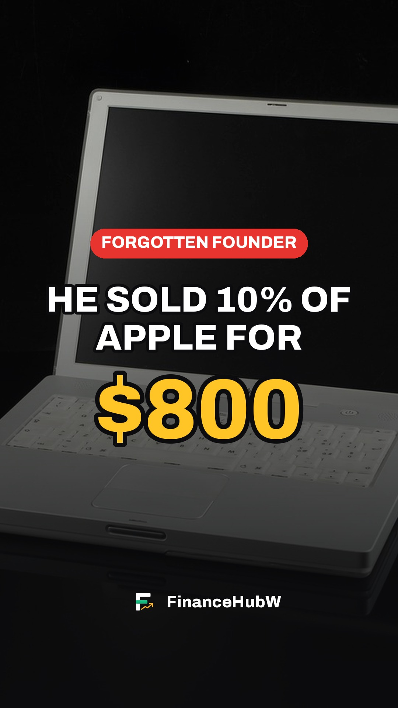</a> | **Apple's forgotten co-founder sold 10% for $800** Money lesson · Money Basics | 19 Oct | 2 | 16% | [YouTube](https://youtube.com/shorts/sh0-7SWR2bc) · [Video](https://github.com/financehubw/FinanceHubW/releases/download/shorts/ronald_wayne.mp4) |
|  | **The most expensive pizza ever bought** Money lesson · Money Basics | 19 Oct | 26 | 71% | [YouTube](https://youtube.com/shorts/2oHoMvAixbE) · [Video](https://github.com/financehubw/FinanceHubW/releases/download/shorts/bitcoin_pizza.mp4) |
|  | **Buffett's secret nobody talks about** Money lesson · Money Basics | 18 Oct | 1,040 | 76% | [YouTube](https://youtube.com/shorts/Zes-1A7ubsw) · [Video](https://github.com/financehubw/FinanceHubW/releases/download/shorts/buffett_after_65.mp4) |
|  | **Blockbuster could have bought Netflix for $50 million** Money lesson · Money Basics | 17 Oct | 1 | 0% | [YouTube](https://youtube.com/shorts/kOdjU6X2fjw) · [Video](https://github.com/financehubw/FinanceHubW/releases/download/shorts/netflix_blockbuster.mp4) |
|  | **The $5,000 debt that lasts 20 years** Money lesson · Money Basics | 16 Oct | 32 | 34% | [YouTube](https://youtube.com/shorts/0fvp4V_448w) · [Video](https://github.com/financehubw/FinanceHubW/releases/download/shorts/credit_card_20_years.mp4) |
|  | **The worst deal in history?** Money lesson · Money Basics | 15 Oct | 271 | 68% | [YouTube](https://youtube.com/shorts/em5KMILUGl0) · [Video](https://github.com/financehubw/FinanceHubW/releases/download/shorts/manhattan_real.mp4) |
| <a href="https://youtube.com/shorts/kWeIUBxcdy4">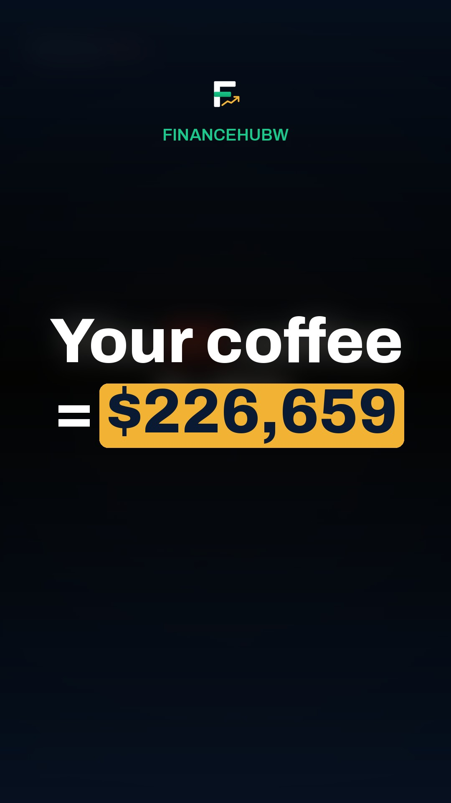</a> | **Your $5 coffee could be worth $226,659** Money lesson · Money Basics | 14 Oct | 2 | 95% | [YouTube](https://youtube.com/shorts/kWeIUBxcdy4) · [Video](https://github.com/financehubw/FinanceHubW/releases/download/shorts/m4_five_dollar_coffee.mp4) |
|  | **When bread cost 200 billion marks** Money lesson · Money Basics | 13 Oct | 22 | 61% | [YouTube](https://youtube.com/shorts/rs7xO5MRc3U) · [Video](https://github.com/financehubw/FinanceHubW/releases/download/shorts/bread_billion_marks.mp4) |
|  | **Your bank pays you 0.5% and charges you 20%** Money lesson · Money Basics | 12 Oct | 78 | 67% | [YouTube](https://youtube.com/shorts/757-gKWyCDQ) · [Video](https://github.com/financehubw/FinanceHubW/releases/download/shorts/bank_spread.mp4) |
|  | **Start investing at 20 or 30? The gap is $298,066** Money lesson · Money Basics | 11 Oct | 101 | 63% | [YouTube](https://youtube.com/shorts/rQPTKTejUpM) · [Video](https://github.com/financehubw/FinanceHubW/releases/download/shorts/m1_ten_year_head_start.mp4) |
| <a href="https://youtube.com/shorts/yNfP99LSP4E">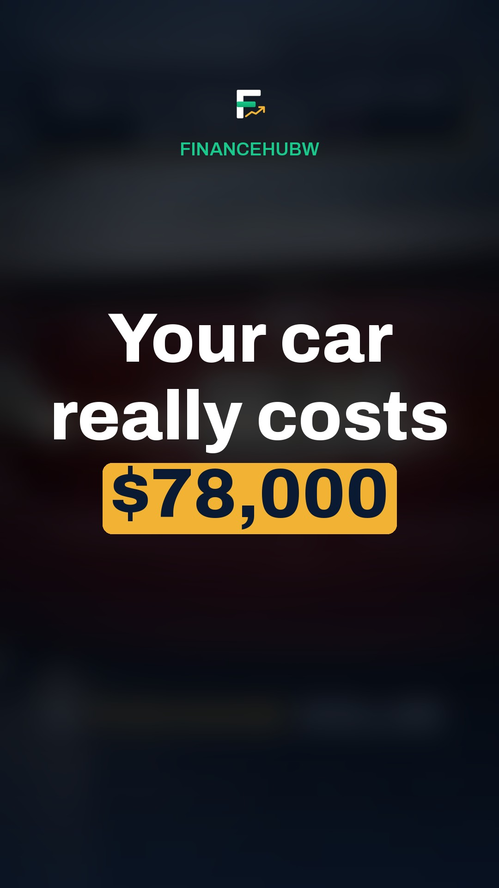</a> | **Your car payment could cost you $78,000** Money lesson · Money Basics | 10 Oct | 474 | 52% | [YouTube](https://youtube.com/shorts/yNfP99LSP4E) · [Video](https://github.com/financehubw/FinanceHubW/releases/download/shorts/car_payment.mp4) |
